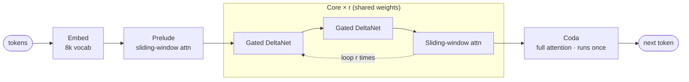

<p align="center">
  
</p>

<p align="center">
  <a href="LICENSE"></a>
  <a href="https://github.com/monstercameron/Gogeta-0/tags"></a>
  <a href="https://monstercameron.github.io/Gogeta-0/"></a>
  
  
  
</p>

<p align="center">
  <b>Quick links</b><br>
  <a href="https://monstercameron.github.io/Gogeta-0/">Site</a> ·
  <a href="https://monstercameron.github.io/Gogeta-0/devlog.html">Devlog page</a> ·
  <a href="https://monstercameron.github.io/Gogeta-0/learn.html">Learn</a> ·
  <a href="https://monstercameron.github.io/Gogeta-0/architecture.html">3D architecture</a> ·
  <a href="#byte-quest-bytes-are-a-main-quest-now">Byte Quest</a> ·
  <a href="experiments/INDEX.md">Experiment index</a> ·
  <a href="experiments/QUEUE.md">Queue</a> ·
  <a href="experiments/claims-status.md">Claims status</a> ·
  <a href="experiments/expenses.json">Expenses</a> ·
  <a href="notes/final-model-plan.md">Final model plan</a> ·
  <a href="DEVLOG.md">DEVLOG.md</a> ·
  <a href="https://github.com/monstercameron/Gogeta-0/tags">Releases / tags</a>
</p>

<p align="center">
  <b>Start here:</b> this README (the pitch and current status) → <a href="experiments/claims-status.md"><code>experiments/claims-status.md</code></a> (<b>the authoritative current state of every claim</b>; this README summarises it and may lag) → <a href="experiments/INDEX.md"><code>experiments/INDEX.md</code></a> (what each experiment asked and found) → <a href="experiments/QUEUE.md"><code>experiments/QUEUE.md</code></a> (what runs next) → <a href="DEVLOG.md"><code>DEVLOG.md</code></a> (versioned history).<br>
  <b>If the README and the ledger disagree, the ledger (<code>experiments/claims/</code>) wins.</b>
</p>

<p align="center">
  <b>Three efficiency tricks. One tiny language model. Fused, or it falls apart.</b><br>
  <a href="https://monstercameron.github.io/Gogeta-0/"><b>Project site</b></a> ·
  <a href="https://monstercameron.github.io/Gogeta-0/learn.html">Start here (plain English)</a> ·
  <a href="DEVLOG.md">Devlog</a> ·
  <a href="experiments/experiments.json">Experiments</a> ·
  <a href="notes/LABNOTEBOOK.md">Lab notebook</a> ·
  <a href="refs/README.md">Reading list</a>
</p>

---

**Gogeta-0** is a small causal language model for Python code, and the first model built on **FusionDance**: an architecture that fuses three separate answers to the three big costs of modern LLMs. It's an open, laptop-scale research project, and every experiment is written up honestly, failures included.

> **Status: v0.4.101. First models trained; the first headline did not survive.** Against the proper transformer control (E10, Hugging Face Llama at the same shapes) at tuned learning rates, swapping five of six attention layers for linear-time layers (E1) is 0.18% worse in the point estimate, not better, on the pre-registered clean-val metric (3 seeds each; the 95% CI spans zero, so no difference is detected; **ledger C5: REFUTED** by its registered rule, v0.4.78, qualified in v0.4.95). The earlier "3.6% lower loss" was against our own dense baseline E0, which turned out to be handicapped by 3.7% (E0-parity fails). The looped version **doesn't pay off yet** (C6/C7: partial). A 3-seed replication at the tuned learning rates (E10 3e-3, E1 6e-3, from the K7 sweep) ran on the N1X for six of its eleven items (E10 and E1, seeds 0–2). It is paused by an operator hold after a thermal kill at 86.6 °C (the partial E11 seed 0 run was discarded; DEVLOG v0.4.73). The 7-seed-per-arm replication on rented RTX 5090s (Phase 2b-5090, DEVLOG v0.4.74–v0.4.79) is done: E1 is **+0.08% vs E10** (paired 95% CI [−0.00087, +0.00132], p 0.64): no difference detected. Its sign matches the N1X test, but the CI spans zero. E11 (negative-eigenvalue Gated DeltaNet) is **equivalent to E1** within ±1% (C196, VERIFIED, 3 seeds, TOST p 0.002). Cloud (SQ220, `experiments/devlogs/SQ220.md`): the RTX 5090 is the fastest and cheapest card per token of the three we tried (C195, PARTIAL: one seed, 20M tokens, the 3090 and 5090 reproduce the N1X's loss within tolerance). A window sweep (SQ214, exploratory, 4 seeds) found E1's sliding window of 256 beats full context by 1.3%. The deduplicated **code-py-v2** dataset is built (v0.4.77: two machines produced byte-identical files; 71% of v1's train docs, 77% of its tokens), unblocking most of the A3 design; v2 validation is redrawn, so its numbers are not comparable with v1. Scale looks like the lever rather than loops: at E2's training FLOPs, 14 unshared blocks (E32, about 2.3× E1's unique parameters) reach about 7% lower clean80 bpc than E1 (C197, VERIFIED on 4 seeds at 200M; the lever is unique parameters, not depth, SQ282). The registered 2×2×2 factorial (F2: GDN × loops × ternary, 217 runs at 20M tokens) found the three ingredients' effects are **not additive**: the interaction is −3.5% (95% CI [−4.3%, −2.7%], C201), meaning their penalties overlap (the registered prediction of +0.5% was wrong); GDN alone is the best cell (7% better than dense), while loops and ternary each cost about 10–13% at this short horizon and the full fusion is still 11% worse than dense (a 200M check, SQ263, is running). The depth result (C197) now replicates on 4 seeds (SQ283: E32 beats E1 by 7.2% and the looped E2 by 12.2%; C197 VERIFIED). At each model's best learning rate, a 5-block model widened to the same parameters (E34) ties E32 (SQ282), so the lever is unique parameters at matched FLOPs, not depth as such; the earlier "E34 is 14% worse" was a learning-rate artifact. The deep stack does need its depth-scaled init (SQ308). The fleet waves 1–3b ran 106 training runs on eight rented RTX 5090s (0 failed runs) for **$6.54** (`experiments/expenses.json`, X4). The fleet is now five boxes after one was destroyed (v0.4.91). SQ243 and SQ241 (wave 4, 4 seeds each) are in: at d = 512 no E1–E10 difference is detected (+0.05%; not a registered equivalence), and at d = 256 E1 is better: 1.24% at the original LRs and 1.71% at each arm's best LR (SQ301, 2 seeds, LRs selected on the same seeds; C198 PARTIAL; the fresh-seed check SQ307 is inconclusive: −1.64%, all four seeds favour E1, but the CI [−3.66%, +0.43%] spans zero). Param-matched E1 is 0.61% worse than E10. SQ200 found our default init costs all-attention stacks about 3.5–3.8% while E1 shows no detected effect (C199 PARTIAL, fixed LRs); SQ308 (20M, 3 seeds) found the 14-block model's edge over E1 depends on the depth-scaled init: 2.6% better with it, no advantage with flat init (C197 limitation). The final model (goal 6) is planned as E61; its training needs the human's approval. The F2 factorial's stage 1 is done (v0.4.91): the blinded seed-level sigma (0.00873) sets N_final at 221, and stage 2 (87 runs) is dispatching. Per-run scores were visible during stage 1 (disclosed in v0.4.89); cell results stay blinded until the analysis. The recurrent decode kernel for Gated DeltaNet now works (C2 verified; the earlier NaN was our call-site bug, C110). **Caveat (K9, v0.4.33):** 41.7% of our validation documents turned out to be near-duplicates of training text, because the corpus repeats many problems, so every loss number so far is inflated. All loss numbers are provisional until the clean-validation re-score; all checkpoints will be re-scored on that cleaned set before any claim is settled. See [Results](#results-so-far) and the [claims list](experiments/claims-status.md). **Early warning (SQ99, exploratory):** on Python from outside the training corpus we see no evidence of E1's in-corpus advantage (3.4% on our cleaned validation set): the out-of-corpus gap is +0.4% with a package-clustered 95% CI of −0.1% to +1.0%. The tuned, replicated checkpoints will be re-checked. A length re-analysis (C193, v0.4.66) adds: on short out-of-corpus files E1 keeps its ~3.9% advantage, on files over ~1,200 tokens it is ~1.1% worse, so the effect looks like long-context ability rather than corpus memorisation (length is confounded with file type; exploratory, n=1). The ledger marks C192 (transfer out of corpus) REFUTED under its registered pooled test, and C193 (the length effect) PARTIAL. And our dense baseline E0 itself trails the reference Llama (E10) by ~3.7% at identical shapes (possible init handicap, SQ200), so E1's headline lead over E0 may be largely a baseline artifact: Phase 2b compares E1 against E10. C16 (GDN recall vs plain linear attention) is INCONCLUSIVE: its K3 control failed the validity gate, and the check must be redesigned ([queue](experiments/QUEUE.md), Q15/Q16).

## The pitch

Modern LLMs are expensive along three separate axes, and the research community has a strong answer to each one *on its own*:

| | The cost | The fighter | The idea |
|---|---|---|---|
| ⚡ | **Context**: attention cost grows with the *square* of the text length | **Linear-time mixers** (Gated DeltaNet) + sliding-window attention | A fixed-size running memory instead of re-reading everything: linear time, constant memory (in principle; our sliding-window kernel still uses a dense mask, so it is O(n²) for now) |
| 🌀 | **Parameters**: more reasoning depth means more layers | **Looped depth** | Run one shared block *r* times: depth comes from compute, not weights |
| 🪶 | **Bits**: every weight stored in 16-bit precision | **Ternary weights** (BitNet b1.58) | Every weight is −1, 0 or +1: ~1.58 bits. With dedicated ternary kernels, matrix multiplies could become additions (ours are simulated, so no speedup yet) |

**FusionDance fuses all three, and Gogeta-0 is the first model to try it.** The bet is that they cover each other's weak spots. Linear-time mixers are weak at multi-step state tracking, and looping adds exactly that depth. Looping costs compute, and ternary weights could make compute cheap once real ternary kernels replace our floating-point simulation.

## The architecture



**The one rule: nothing quadratic lives inside the loop.** Anything inside the loop is paid *r* times, so the only full-attention layer sits outside it and runs once. It's also the only layer whose memory grows with the length of the input.

The diagram above is the **token-level** model that E0–E11 train. A second, planned architecture, the **coarse-to-fine byte model**, keeps the same stack but changes *what* it runs on and *where* the loop sits: see [Byte Quest](#byte-quest-bytes-are-a-main-quest-now) below. It is a design concept, not a trained model.

## Byte Quest: bytes are a main quest now

<p align="center">
  
</p>

**Why bytes.** No tokenizer to train or ship; exact characters (identifiers, digits, indentation) instead of opaque token ids; robustness to odd spellings and unseen text; and an 8,192-way output head (21% of E1's per-token compute) replaced by a 256-way one.

**The coarse-to-fine idea: depth where the information is, iteration where the errors are.** A narrow byte encoder pools every *P* bytes into a patch. The E1-style global stack runs once, on patches only (1/*P* as many positions). Its output is shifted by **one patch** so a byte never sees its own patch's summary (the causal fix from MegaByte), expanded back to byte positions, and then a small **shared-weight byte refinement loop** runs *r* times at byte resolution, with the raw bytes re-injected each pass and a loss on every pass. The skeleton (encoder → global patches → decoder) is known work (MegaByte, BLT, H-Net); the hypothesis worth testing is the narrower one, that *shared* byte refinement beats an unshared decoder of equal FLOPs. Design: [`notes/analysis-coarse-to-fine.md`](notes/analysis-coarse-to-fine.md).

**Estimated cost** (estimates from that note, not measurements): at P = 4 the design costs about 1.04× / 1.19× / 1.48× E1's training FLOPs per token of text at r = 1 / 2 / 4, versus about 3.6× for a flat byte-level E1.

| Experiment | Question (planned, not run) |
|---|---|
| [E12: flat byte-level E1](experiments/cards/E12.md) | Is a flat byte model (vocab 256, T = 4,096 bytes, E1's mixers) competitive with BPE-E1 at matched FLOPs and at matched bytes? |
| [E13: patch granularity sweep](experiments/cards/E13.md) | How does patch size (P = 2 / 4 / 8) trade quality against cost with a single-pass byte decoder? |
| [E14: byte refinement loop sweep](experiments/cards/E14.md) | At matched FLOPs, does a shared-weight refinement loop (r = 1 / 2 / 4, gated, per-pass loss) beat a single-pass decoder and an equal-FLOP unshared decoder? |
| [E15: parallel-then-refine decoding](experiments/cards/E15.md) | Can predicting all P bytes of the next patch at once and refining over r < P passes match byte-autoregressive quality? |
| [E16: byte quest × FusionDance](experiments/cards/E16.md) | Does the best byte decoder combine with a looped global core (E2-style) and a ternary global core? |

All five are registered (arc "Byte Quest (granularity x loops)" in [`experiments/experiments.json`](experiments/experiments.json)). Their predictions are registered in [`experiments/checks/PREDICTIONS.md`](experiments/checks/PREDICTIONS.md) (section "Registered Byte Quest predictions E12-E16", v0.4.68), and the 30 staged configs are bound to those predictions by hash (same file, v0.4.69). **First byte runs (v0.4.85, RTX 5090, 20M bytes, exploratory):** the SQ188 LR check picked lr 3e-3, and the E13 patch-size sweep is underway (P = 2 is best so far; the 200M runs are in progress).

**The honest caveat.** The literature says byte models trail BPE below roughly 4B parameters on code ([`notes/research-byte-level-2025-26.md`](notes/research-byte-level-2025-26.md)), so "beats BPE-E1" is *not* the claim. The arc's claims are about **granularity and loops**: how patch size trades quality for cost, and whether shared byte-level refinement buys anything over equal-FLOP unshared depth (E2's loop did not pay at token level, ledger C6). If all byte variants trail BPE but the loop beats its control, that is still a result.

Explore it: the [3D architecture page](https://monstercameron.github.io/Gogeta-0/architecture.html?model=c2f_byte) has a "C2F-byte (concept)" model with a patch-size slider and the loops slider; the [site section](https://monstercameron.github.io/Gogeta-0/#bytes) has the same diagram.

## Goals

1. **Fuse the three:** show that linear-time mixing, looped depth and ternary weights *stack* in one causal LLM.
2. **Think in loops, not out loud:** replace part of chain-of-thought with silent latent loops, spending compute instead of tokens and memory.
3. **The Rival Loop:** build critique → fix into the recurrence, with per-loop scoring, a grounded critic head, and adversarial damage-and-repair.
4. **Make loops pay at inference:** self-speculative decoding (draft with a few loops, verify with all of them, no extra model).
5. **Do it on a laptop:** small models, one-ingredient-at-a-time ablations, and results reported as *scaling shapes*: quality per bit, per FLOP, and cost vs context length.
6. **Ship it on a gaming GPU:** a final model, sized by our own scaling fit (primary target ~1.2B params), that runs with a KV/state cache and lossless speculative decoding on one 24 GB RTX 3090/4090 ([plan](notes/final-model-plan.md)).

## Results so far

200M tokens of Python each, seed 0, full validation split (contaminated: see K9; the registered verdicts use clean val). Lower loss is better.

| Experiment | Layout | Params (non-emb) | Val loss | vs E0 | Compute |
|---|---|---|---|---|---|
| [E0: dense baseline](experiments/writeups/E0.md) | 6 × full attention | 10.6M | 0.606 | n/a | 1.0× |
| [**E1: linear-time mixers**](experiments/writeups/E1.md) | 1 attention + 3 Gated DeltaNet + 2 sliding-window | 11.1M | **0.585** | **−3.6%** | 0.94× |
| E10: Llama control (the proper baseline) | 6 × full attention (Hugging Face Llama, same shapes) | 10.6M | 0.582 | −4.0% | 1.0× |
| [E2: looped core](experiments/writeups/E2.md) | `[SWA] → [GDN, GDN, SWA] × 4 → [attn]` | 9.5M | 0.619 | +2.0% | 2.0× |

**In plain English:**
- **Against the right control, the cheaper layers show no detected advantage.** E1 beat our E0 baseline, but E0 was handicapped: the Llama control E10 at the same shapes is 4% better than E0. In the registered 3-seed test at tuned learning rates, E1 is 0.18% worse than E10 in the point estimate on clean validation, with a CI that spans zero (C5: REFUTED by its registered rule, v0.4.78, qualified in v0.4.95). The 7-seed replication on rented RTX 5090s is done: E1 is +0.08% vs E10, no difference detected.
- **Loops don't pay yet.** The looped model was 2% worse at twice the cost. On the 5090s, E2 is 2.6% worse than its unlooped twin E9 (one seed each, descriptive; C6).
- **Scale, so far.** At matched FLOPs, a 14-block unshared stack with about 2.3× the unique parameters beats E1 by about 7% on four seeds at 200M (C197, VERIFIED). SQ243/SQ241/SQ301 test the width axis: no difference detected at d = 512, E1 1.2–1.7% better at d = 256 (C198, PARTIAL), and param-matched E1 0.61% worse than E10.
- **Our best guess at why (not yet settled; C7 partial, one checkpoint).** Tested with 1–12 loops, it does best at 4, the average it was trained with, and gets *worse* beyond the trained range. It learned a routine, not "more thinking = better", which is what the Rival Loop is designed to fix.
- **Not confirmed yet:** each result is a single seed or a single-SKU replication. The registered confirmatory test is still the N1X one (Q12), and the unlooped control ([E9](experiments/writeups/E9.md)) has one 5090 seed.

Every experiment has a page with interactive charts and a plain-English explainer on the **[project site](https://monstercameron.github.io/Gogeta-0/)**, e.g. [E2: why the loop disappoints](https://monstercameron.github.io/Gogeta-0/experiments/E2.html). The **[full roadmap](experiments/experiments.json)** runs E0 → E9: ternary weights, the full fusion (→ `v1.0.0`), adaptive loops, the Rival Loop, loops vs chain-of-thought, and self-speculative decoding.

## Run report forms

A **run report form** is a one-page report for a single finished training run: what the experiment asked and predicted, the architecture and hyperparameters, the commit and environment, the final metrics, a visible data caveat (K9: the validation split is inflated), the related claims in the ledger, and graphs (loss, learning rate, gradient norm, throughput, and a comparison with sibling runs). The cockpit fills the facts; an agent writes the narrative (purpose, what happened, comparison with siblings, verdict, follow-ups) and every field is tagged as machine-filled or agent-written.

- **Where they live:** [`experiments/run-forms/INDEX.md`](experiments/run-forms/INDEX.md) lists every run with its form; each form is `experiments/run-forms/<run_id>.md` with its SVG charts in `experiments/run-forms/<run_id>/`.
- **How an agent fills one:** call the cockpit MCP tool `gogeta_run_form_draft` with the run id, read the auto-filled draft and the evidence it links, write the narrative fields, then call `gogeta_run_form_submit` (it refuses empty narrative fields and any ledger claim without an evidence pointer). `gogeta_brief` lists finished runs that still lack a form.
- **How a human views or creates one:** start the cockpit with `bash cockpit/cockpit.sh`, open the **Runs** tab (`h`), press **Run forms** to see every run as none / draft / filled, and **Draft form** to start one. Details: [`cockpit/README.md`](cockpit/README.md), "Run forms".
- **The rule:** every finished run gets a form.

## Quick start

Tested on Ubuntu 24.04 under WSL2 with an NVIDIA Blackwell GPU (ARM64). Any recent CUDA GPU that runs Triton should work.

```bash
# 1. Environment (Triton needs the Python headers)
sudo apt-get install -y python3.12-venv python3.12-dev
python3 -m venv ~/.venvs/gogeta && source ~/.venvs/gogeta/bin/activate
pip install torch --index-url https://download.pytorch.org/whl/cu130
pip install -e .

# 2. Check the GPU kernels and the model
python tests/test_gdn_kernels.py
python tests/test_model.py

# 3. Build the dataset (downloads ~2.8 GB; Python-only subset, ~262M tokens)
python tools/prepare_data.py

# 4. Train (the configs are E0/E1/E2/E9) and watch it in the local dashboard
python -m gogeta.train --config configs/e1_hybrid.json --compile
python tools/dashboard.py          # http://127.0.0.1:7861

# 5. Rebuild the project site after recording results
python tools/build_site_data.py
python -m http.server 8791 --directory docs
```

Data, checkpoints and run logs go to `~/fusiondance-data/` (set `GOGETA_DATA` to change it), never into the repo. Tracking is fully local ([Trackio](https://huggingface.co/docs/trackio)); nothing is uploaded.

## Repository layout

```
gogeta/              the package: model.py (FusionDance), train.py, tracking.py, assets/ (tokenizer)
configs/             one JSON config per experiment
tests/               GPU kernel check against a reference + model correctness tests
tools/               data pipeline, run queue, result recorder, dashboard, site builder
experiments/         experiments.json (registry: predictions, status, results),
                     writeups/ (per-experiment explainers), curves/ (eval curves)
docs/                the GitHub Pages site (landing, devlog, primer, a page per experiment)
site-src/            source for the "Start here" primer
notes/               LABNOTEBOOK.md (timestamped evidence) + sketch.md (design scratchpad)
refs/                55-paper reading list + fetch script (PDFs are not committed)
DEVLOG.md            versioned history: every entry is a commit and a git tag
AGENTS.md            working rules for humans and AI agents in this repo
```

## How the research is run

- **Predictions first.** Every experiment's prediction is committed *before* it runs, then scored hit/miss afterwards.
- **One ingredient at a time**, so a failed fusion can be traced to a specific change.
- **Provenance.** Every run records its git commit, config and seed, and runs for a release refuse to start on uncommitted code.
- **Devlog = commits = versions.** Each entry in [`DEVLOG.md`](DEVLOG.md) is exactly one commit and one semver tag (`0.y.z` until the full fusion works).
- **Everything explained twice:** a detailed breakdown for researchers, and a plain-English section for everyone else.

Full rules are in [`AGENTS.md`](AGENTS.md).

## Project site

Live at **[https://monstercameron.github.io/Gogeta-0/](https://monstercameron.github.io/Gogeta-0/)**. GitHub Pages deploys it straight from `main` / `docs` on every push; it's static, so there's no build step on GitHub. Regenerate it locally with `python tools/build_site_data.py` before committing. Every version is a git tag ([all tags](https://github.com/monstercameron/Gogeta-0/tags)).

## Standing on the shoulders of

BitNet b1.58, Mamba / Mamba-2, Gated DeltaNet, Kimi Linear, Samba, Zamba, Universal Transformers, Recurrent Depth (Huginn), Mixture-of-Recursions, TRM / HRM, LayerSkip, DFlash, and more: 55 papers with notes in [`refs/README.md`](refs/README.md). The closest prior work we know of, a TRM-style recursive Mamba-2/attention hybrid, is flagged there. FusionDance's bet is the *full* fusion, ternary included, aimed at a general causal LLM.

**Credits**
- **Training data:** [OpenCoder-LLM/opc-annealing-corpus](https://huggingface.co/datasets/OpenCoder-LLM/opc-annealing-corpus) (`algorithmic_corpus` + `synthetic_code_snippet`, Python only), licensed under **ODC-By 1.0**. The tokenizer in `gogeta/assets/` was trained on it. The data itself is not redistributed here.
- **Kernels:** [flash-linear-attention](https://github.com/fla-org/flash-linear-attention) (Gated DeltaNet chunk kernel). **Tracking:** [Trackio](https://huggingface.co/docs/trackio). **Framework:** PyTorch.

## License

Code and documentation: [MIT](LICENSE). The dataset keeps its own license (ODC-By 1.0); paper PDFs are fetched from arXiv and not redistributed.

---

<sub>*The name is a fan homage to a certain two-person fusion dance: two fighters become one stronger one, but only if the dance is perfectly in sync. This is an independent research project, not affiliated with or endorsed by the Dragon Ball rights holders.*</sub>
