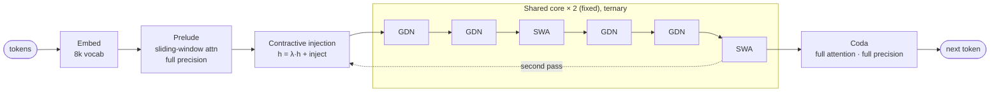

<p align="center">
  
</p>

<p align="center">
  <a href="LICENSE"></a>
  <a href="https://github.com/monstercameron/Gogeta-0/tags"></a>
  <a href="https://monstercameron.github.io/Gogeta-0/"></a>
  
  
  
</p>

<p align="center">
  <b>Quick links</b><br>
  <a href="https://monstercameron.github.io/Gogeta-0/">Site</a> ·
  <a href="https://monstercameron.github.io/Gogeta-0/devlog.html">Devlog page</a> ·
  <a href="https://monstercameron.github.io/Gogeta-0/learn.html">Learn</a> ·
  <a href="https://monstercameron.github.io/Gogeta-0/architecture.html">3D architecture</a> ·
  <a href="#byte-quest-coarse-to-fine-bytes">Byte Quest</a> ·
  <a href="experiments/INDEX.md">Experiment index</a> ·
  <a href="experiments/QUEUE.md">Queue</a> ·
  <a href="experiments/claims-status.md">Claims status</a> ·
  <a href="experiments/expenses.json">Expenses</a> ·
  <a href="notes/final-model-plan.md">Final model plan</a> ·
  <a href="DEVLOG.md">DEVLOG.md</a> ·
  <a href="https://github.com/monstercameron/Gogeta-0/tags">Releases / tags</a>
</p>

<p align="center">
  <b>Start here:</b> this README (the pitch and current status) → <a href="experiments/claims-status.md"><code>experiments/claims-status.md</code></a> (<b>the authoritative current state of every claim</b>; this README summarises it and may lag) → <a href="experiments/INDEX.md"><code>experiments/INDEX.md</code></a> (what each experiment asked and found) → <a href="experiments/QUEUE.md"><code>experiments/QUEUE.md</code></a> (what runs next) → <a href="DEVLOG.md"><code>DEVLOG.md</code></a> (versioned history).<br>
  <b>If the README and the ledger disagree, the ledger (<code>experiments/claims/</code>) wins.</b>
</p>

<p align="center">
  <b>Three efficiency tricks. One tiny language model. Fused, or it falls apart.</b><br>
  <a href="https://monstercameron.github.io/Gogeta-0/"><b>Project site</b></a> ·
  <a href="https://monstercameron.github.io/Gogeta-0/learn.html">Start here (plain English)</a> ·
  <a href="DEVLOG.md">Devlog</a> ·
  <a href="experiments/experiments.json">Experiments</a> ·
  <a href="notes/LABNOTEBOOK.md">Lab notebook</a> ·
  <a href="refs/README.md">Reading list</a>
</p>

---

**Gogeta-0** is a small causal language model for Python code, and the first model built on **FusionDance**: an architecture that fuses three separate answers to the three big costs of modern LLMs. It's an open, laptop-scale research project, and every experiment is written up honestly, failures included.

> **Status: v0.5.61. Assembled and measured at 15M parameters; research paused.** Every FusionDance component trains and runs together, and the best recipe (A2s) beats the naive fusion by 16.7%, but it still trails a plain dense model in corpus. The next steps (a GPU batch, a bigger dataset and the final 1.2B model) wait on the human. Where things stand and how to resume: [`notes/CONTINUATION.md`](notes/CONTINUATION.md).

- **What works:** linear-time GDN mixers, sliding-window and full attention, a shared looped core, BitNet ternary weights, a ternary MoE core, a coarse-to-fine byte decoder and self-speculative decoding all train end to end. Causality is exact on the production CUDA kernels (C3), and the code sandbox for RL is hardened (C83, C106).
- **The headline:** the assembled model A2s beats the naive full fusion E27 by **16.7%** on clean80 bits per character (C209, VERIFIED; 16.2% at matched FLOPs). About **61%** of that gap is A2s's bigger shared core and its extra parameters. The rest is the A2 bundle (C215, VERIFIED: -6.85% at matched parameters and FLOPs), which is probably mostly the extra precision of its full-precision ends.
- **The gap that remains:** in corpus A2s is **8.6% worse than dense** E20 at the same tokens. Ternary weights cost about +9.7% and the loop about +3.1%. Out of corpus (Python files from outside the training data), the ternary cost is not distinguishable from 0 and the loop *helps* (-1.9%, C214, VERIFIED). The final model is judged out of corpus.
- **Not viable yet:** the byte decoder costs +14.4% against the token head (C210, UNVERIFIED pending clean80), and self-speculative decoding is not lossless under int8 activations (C19).
- **Spend so far:** $44.85 of rented GPU time ([`experiments/expenses.json`](experiments/expenses.json)). The authoritative state of every claim is [`experiments/claims-status.md`](experiments/claims-status.md).

## The pitch

Modern LLMs are expensive along three separate axes, and the research community has a strong answer to each one *on its own*:

| | The cost | The fighter | The idea |
|---|---|---|---|
| ⚡ | **Context**: attention cost grows with the *square* of the text length | **Linear-time mixers** (Gated DeltaNet) + sliding-window attention | A fixed-size running memory instead of re-reading everything: linear time, constant memory (in principle; our sliding-window kernel still uses a dense mask, so it is O(n²) for now) |
| 🌀 | **Parameters**: more reasoning depth means more layers | **Looped depth** | Run one shared block *r* times: depth comes from compute, not weights |
| 🪶 | **Bits**: every weight stored in 16-bit precision | **Ternary weights** (BitNet b1.58) | Every weight is −1, 0 or +1: ~1.58 bits. With dedicated ternary kernels, matrix multiplies could become additions (ours are simulated, so no speedup yet) |

**FusionDance fuses all three, and Gogeta-0 is the first model to try it.** The bet was that they cover each other's weak spots. At 200M tokens the naive fusion showed the opposite: the three penalties compound ([C202](experiments/claims-status.md), PARTIAL; the full fusion is 30.8% worse than dense). Since v0.5.0 the project has been in an **assembly phase**: fix one weak spot at a time on the full fusion, then stack only what works.

## The architecture (as trained: A2s)



- **Shared core:** six blocks (four Gated DeltaNet, two sliding-window attention) run twice with the same ternary weights. Before each pass, the prelude's output is re-injected through a learned contractive gate (λ about 0.75).
- **Full precision outside the loop:** the prelude, coda and injection stay full precision. On the naive fusion that one change alone is worth -7.6% (C205).
- **Fixed loop count:** a fixed r beats a random one (C212, PARTIAL).
- **One full-attention layer:** the coda's full attention runs once, outside the loop.
- **Size:** about 15.1M unique non-embedding parameters, trained on 200M tokens of the deduplicated `code-py-v2` corpus. Config: [`experiments/staged-configs/a2/a2s.json`](experiments/staged-configs/a2/a2s.json).
- **Inside the model:** the [data-flow atlas](experiments/devlogs/SQ439.md) (SQ439, descriptive) measured what passes between these layers:
  - the first sliding-window layer behaves as a causal moving average;
  - pass 1 transforms the state and pass 2 refines it;
  - every pass contracts perturbations;
  - the coda does the most work on unfamiliar code;
  - int8 activations are safe.

## Results so far

All numbers are clean80 doc-level bits per character: validation documents with under 80% 13-gram overlap with training, which is our primary metric, since the raw split was 41.7% near-duplicates (K9). They are paired by seed, and lower is better. Statuses are from the [claims ledger](experiments/claims-status.md).

| Question | Result | Claim |
|---|---|---|
| Do linear-time mixers beat a tuned transformer? | E1 hybrid vs Llama control E10: +0.08% (7 seeds), no difference detected | C5, REFUTED by its registered rule |
| Do loops beat more unique parameters? | No. At matched FLOPs, 14 unshared blocks beat E1 by about 7% (4 seeds); unique params buy about 2.4x more than a second pass | C197, VERIFIED |
| Do the three ingredients stack naively? | No. They compound: interaction +6.21 log-points, and the full fusion is 30.8% worse than dense | C202, PARTIAL |
| Does the assembled recipe fix the fusion? | A2s vs E27: **-16.67%** [-17.86, -15.46]; at matched FLOPs -16.18% | C209, VERIFIED |
| How much of that is parameters? | About 61% (S = 0.61 [0.57, 0.65]); F-6 (E27's recipe on A2s's core) vs E27: -10.5% | C209 (decomposition) |
| What is the rest? | A2s vs F-6 at matched params and FLOPs: **-6.85%** [-8.02, -5.67], probably mostly the full-precision ends | C215, VERIFIED (scoped) |
| How far from dense? | A2s vs E20: +8.58% [7.99, 9.18]; its full-precision twin A2f: -0.86% [-2.57, +0.89], no difference detected | E63 (A2) |
| Out of corpus? | Ternary cost +0.42% [-0.92, +1.77]; loop cost **-1.91%** [-3.40, -0.40]; assembly gain -11.3% | C214, VERIFIED; C213, PARTIAL |
| Every part at once (ternary MoE core)? | Every fix counts, but A3mx trails the unshared GDN stack by 4.4% and is not shown to tie dense | C208, VERIFIED |
| Coarse-to-fine bytes? | +14.4% vs the token head, so not viable yet | C210, UNVERIFIED |
| Long context beyond the training length? | GDN hybrid vs dense: -60.7% [-69.8, -51.5] (3 seeds) | SQ351, exploratory |

What the per-document re-score adds (SQ239, SQ410, SQ385; descriptive, 30 checkpoints):
- **Every gap grows with overlap with the training data:** ternary +5.4% to +18.1%, loop +1.5% to +5.6%, assembly gain -13.8% to -24.9%. Part of what these comparisons measure is memorisation.
- **Both costs fade late in a document:** at tokens 513-1,024 the loop cost is -3.1% and the ternary cost +0.2%.

The full history is in [`DEVLOG.md`](DEVLOG.md), and every experiment has a page with charts and a plain-English explainer on the **[project site](https://monstercameron.github.io/Gogeta-0/)**.

## Goals

| Goal | State |
|---|---|
| 1. **Fuse the three** (linear-time mixing, looped depth, ternary weights) | Assembled and working; not yet competitive with dense in corpus |
| 2. **Think in loops, not out loud** | Loops help out of corpus and late in context, but per FLOP unique parameters still win (C197) |
| 3. **The Rival Loop** (critique → fix inside the recurrence) | Not built |
| 4. **Make loops pay at inference** (self-speculative decoding) | Built; not lossless under int8 activations |
| 5. **Do it on a laptop**, reporting scaling shapes | All results are 15M-parameter models; scale is untested |
| 6. **Ship it on a gaming GPU** (about 1.2B params, [plan](notes/final-model-plan.md)) | Waits on a bigger dataset (code-py-v3, human approval) and the human's go-ahead for training |

## Byte Quest: coarse-to-fine bytes

<p align="center">
  
</p>

**The idea:** no tokenizer, exact characters, and depth where the information is. A global stack runs on patches of bytes, and a small shared-weight loop refines at byte resolution ([design note](notes/analysis-coarse-to-fine.md)).

**What happened:**
- **Fixed byte patches were far too costly:** E13 scored +36% and +63% bits per char vs E1 (exploratory).
- **Tokens as patches around the A3 backbone was better but still costly:** A4 (E65, v0.5.20) costs +14.4% against the token head. Its second shared byte pass does help (-1.7%).
- **Bytes are not viable at this scale yet.** That matches the literature, where bytes trail BPE below about 4B parameters on code. The design-around is SQ394. E12 and E14-E16 are registered but not run.

## Run report forms

A **run report form** is a one-page report for a single finished training run: what the experiment asked and predicted, the architecture and hyperparameters, the commit and environment, the final metrics, a visible data caveat (K9: the validation split is inflated), the related claims in the ledger, and graphs (loss, learning rate, gradient norm, throughput, and a comparison with sibling runs). The cockpit fills the facts; an agent writes the narrative (purpose, what happened, comparison with siblings, verdict, follow-ups) and every field is tagged as machine-filled or agent-written.

- **Where they live:** [`experiments/run-forms/INDEX.md`](experiments/run-forms/INDEX.md) lists every run with its form; each form is `experiments/run-forms/<run_id>.md` with its SVG charts in `experiments/run-forms/<run_id>/`.
- **How an agent fills one:** call the cockpit MCP tool `gogeta_run_form_draft` with the run id, read the auto-filled draft and the evidence it links, write the narrative fields, then call `gogeta_run_form_submit` (it refuses empty narrative fields and any ledger claim without an evidence pointer). `gogeta_brief` lists finished runs that still lack a form.
- **How a human views or creates one:** start the cockpit with `bash cockpit/cockpit.sh`, open the **Runs** tab (`h`), press **Run forms** to see every run as none / draft / filled, and **Draft form** to start one. Details: [`cockpit/README.md`](cockpit/README.md), "Run forms".
- **The rule:** every finished run gets a form.

## Quick start

Tested on Ubuntu 24.04 under WSL2 with an NVIDIA Blackwell GPU (ARM64). Any recent CUDA GPU that runs Triton should work.

**No GPU or data download needed for a first check:** after step 1, `CUDA_VISIBLE_DEVICES= python -m unittest tests.test_options tests.test_moe` builds and trains tiny FusionDance models on synthetic tokens on CPU, checking bit-identical defaults, causality and the MoE option (28 tests, about 10 s; 1 GDN test is skipped without a GPU).

**Start reading here:** the status block at the top, then the results table. The questions that shaped the project:
- the hybrid shows no detected advantage over a tuned Llama control (C5);
- more unique parameters at matched FLOPs beat loops (C197);
- the naive fusion's penalties compound at 200M (C202), and the assembled recipe fixes most of that (C209, C215).

### How to follow one result

Worked example: [C209](experiments/claims/views/C209.md), the claim that the assembled model A2s beats the full fusion E27 by 16.7% at 200M tokens (VERIFIED at recipe level, not parameter-matched).

- **The claim's ledger view:** [`experiments/claims/views/C209.md`](experiments/claims/views/C209.md). It is generated from the append-only ledger (`experiments/claims/ledger/C209.jsonl`) and shows the definition, the current status, the limitations and every event.
- **The evidence:** [`experiments/checks/results/a2_assembled.json`](experiments/checks/results/a2_assembled.json) has the paired per-seed numbers and the 95% intervals. The FLOP-matched figure (-16.2%, against E27 trained on 221.6M tokens) is in [`experiments/checks/results/a2_compute_matched.json`](experiments/checks/results/a2_compute_matched.json).
- **The registration:** the predictions and pass criteria were written before the runs, in [`experiments/checks/PREDICTIONS.md`](experiments/checks/PREDICTIONS.md), section "A2 assembled model", with the compute match in "A2 amendment 3".
- **The control for the parameter confound:** C209 is not parameter-matched (about 15.1M vs 9.5M unique parameters). GPU batch C1 (registered v0.5.50, amended v0.5.51; section "GPU batch C1" in the same file) ran F-6, E27's recipe on A2s's 6-block core, on fresh seeds 2-4 at 200M tokens. Its readout (v0.5.56) is in [`experiments/checks/results/sq419.json`](experiments/checks/results/sq419.json): F-6 vs E27 -10.5%, A2s vs F-6 -6.85% (C215, probably mostly the precision scope; SQ447 is the bit-matched control). Its readout is [`experiments/checks/sq419_f6.py`](experiments/checks/sq419_f6.py).
- **The queue:** [`experiments/QUEUE.md`](experiments/QUEUE.md), item 48 (SQ419), done in v0.5.56.

### Glossary

- **A1 / A2 / A3 / A4:** assembly stages. A1 is the one-change screen (one compensation at a time on the full fusion, E62, two seeds). A2 is the stacked assembled model on fresh seeds, against dense and GDN references (E63). A3 is the all-parts model on fresh seeds 5-7 (registered v0.5.10): a ternary MoE FFN in the shared core, plus full-precision mixers or FFN to locate ternary's cost. A4 is the full stack, registered in v0.5.15 and final in v0.5.20: coarse-to-fine bytes (tokens as patches) around the A3 backbone, with a shared-weight byte refinement loop and an unshared single-pass decoder as a parameter-matched control (v0.5.12).
- **E-numbers:** registered experiments (E0 to E67), each with a row in [`experiments/INDEX.md`](experiments/INDEX.md).
- **F2 cells 000 to 111:** the registered 2×2×2 factorial of GDN mixer × shared loops × ternary weights, one digit per ingredient (1 = on). 000 is the all-off base and 111 is the full fusion.
- **clean80 / clean50:** validation documents with under 80% (clean80, the primary metric) or under 50% (clean50) of their 13-grams in the training data.
- **Matched FLOPs:** arms compared at equal analytic training FLOPs per token. Equal wall-clock is a separate check (SQ338, v0.4.104).
- **Parameter-changed arm:** an arm that changes the unique parameter count (such as A1g's 6×2 loop shape). It is read against C197's parameter lever, not as a compensation.
- **Log-points:** 100 × the natural-log ratio of two losses. +6.21 log-points is +6.4% as a ratio (v0.4.104).
- **What A2 can claim:** a recipe-level claim (the assembled recipe vs the full fusion and vs dense), not a claim about which ingredient causes the gain. Mechanism claims need the factorials and the A3 ladder (v0.5.6).
- **Statuses:** VERIFIED means the registered criteria were met on saved output. PARTIAL means some evidence, but not all criteria. UNVERIFIED means no saved-output evidence yet. It does NOT mean "probably true".

```bash
# 1. Environment (Triton needs the Python headers)
sudo apt-get install -y python3.12-venv python3.12-dev
python3 -m venv ~/.venvs/gogeta && source ~/.venvs/gogeta/bin/activate
pip install torch --index-url https://download.pytorch.org/whl/cu130
pip install -e .

# 2. Check the GPU kernels and the model
python tests/test_gdn_kernels.py
python tests/test_model.py

# 3. Build the dataset (downloads ~2.8 GB; Python-only subset, ~262M tokens)
python tools/prepare_data.py

# 4. Train and watch it in the local dashboard (configs/ has E0/E1/E2/E9; experiments/staged-configs/a3/ has the assembled models)
python -m gogeta.train --config configs/e1_hybrid.json --compile
python -m gogeta.train --config experiments/staged-configs/a3/a3mx.json --compile
python tools/dashboard.py          # http://127.0.0.1:7861

# 5. Rebuild the project site after recording results
python tools/build_site_data.py
python -m http.server 8791 --directory docs
```

Data, checkpoints and run logs go to `~/fusiondance-data/` (set `GOGETA_DATA` to change it), never into the repo. Tracking is fully local ([Trackio](https://huggingface.co/docs/trackio)); nothing is uploaded.

## Repository layout

```
gogeta/              the package: model.py (FusionDance), train.py, tracking.py, assets/ (tokenizer)
configs/             one JSON config per experiment
tests/               GPU kernel check against a reference + model correctness tests
tools/               data pipeline, run queue, result recorder, dashboard, site builder
experiments/         experiments.json (registry: predictions, status, results),
                     writeups/ (per-experiment explainers), curves/ (eval curves)
docs/                the GitHub Pages site (landing, devlog, primer, a page per experiment)
site-src/            source for the "Start here" primer
notes/               LABNOTEBOOK.md (timestamped evidence) + sketch.md (design scratchpad)
refs/                55-paper reading list + fetch script (PDFs are not committed)
DEVLOG.md            versioned history: every entry is a commit and a git tag
AGENTS.md            working rules for humans and AI agents in this repo
```

## How the research is run

- **Predictions first.** Every experiment's prediction is committed *before* it runs, then scored hit/miss afterwards.
- **One ingredient at a time**, so a failed fusion can be traced to a specific change.
- **Provenance.** Every run records its git commit, config and seed, and runs for a release refuse to start on uncommitted code.
- **Devlog = commits = versions.** Each entry in [`DEVLOG.md`](DEVLOG.md) is exactly one commit and one semver tag (`0.y.z` until the full fusion works).
- **Everything explained twice:** a detailed breakdown for researchers, and a plain-English section for everyone else.

Full rules are in [`AGENTS.md`](AGENTS.md).

## Project site

Live at **[https://monstercameron.github.io/Gogeta-0/](https://monstercameron.github.io/Gogeta-0/)**. GitHub Pages deploys it straight from `main` / `docs` on every push; it's static, so there's no build step on GitHub. Regenerate it locally with `python tools/build_site_data.py` before committing. Every version is a git tag ([all tags](https://github.com/monstercameron/Gogeta-0/tags)).

## Standing on the shoulders of

BitNet b1.58, Mamba / Mamba-2, Gated DeltaNet, Kimi Linear, Samba, Zamba, Universal Transformers, Recurrent Depth (Huginn), Mixture-of-Recursions, TRM / HRM, LayerSkip, DFlash, and more: 55 papers with notes in [`refs/README.md`](refs/README.md). The closest prior work we know of, a TRM-style recursive Mamba-2/attention hybrid, is flagged there. FusionDance's bet is the *full* fusion, ternary included, aimed at a general causal LLM.

**Credits**
- **Training data:** [OpenCoder-LLM/opc-annealing-corpus](https://huggingface.co/datasets/OpenCoder-LLM/opc-annealing-corpus) (`algorithmic_corpus` + `synthetic_code_snippet`, Python only), licensed under **ODC-By 1.0**. The tokenizer in `gogeta/assets/` was trained on it. The data itself is not redistributed here.
- **Kernels:** [flash-linear-attention](https://github.com/fla-org/flash-linear-attention) (Gated DeltaNet chunk kernel). **Tracking:** [Trackio](https://huggingface.co/docs/trackio). **Framework:** PyTorch.

## License

Code and documentation: [MIT](LICENSE). The dataset keeps its own license (ODC-By 1.0); paper PDFs are fetched from arXiv and not redistributed.

---

<sub>*The name is a fan homage to a certain two-person fusion dance: two fighters become one stronger one, but only if the dance is perfectly in sync. This is an independent research project, not affiliated with or endorsed by the Dragon Ball rights holders.*</sub>
