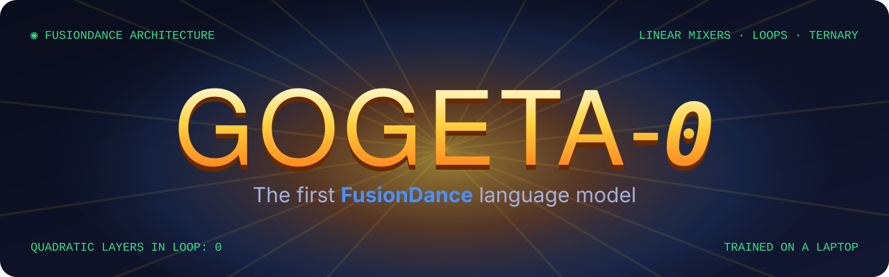
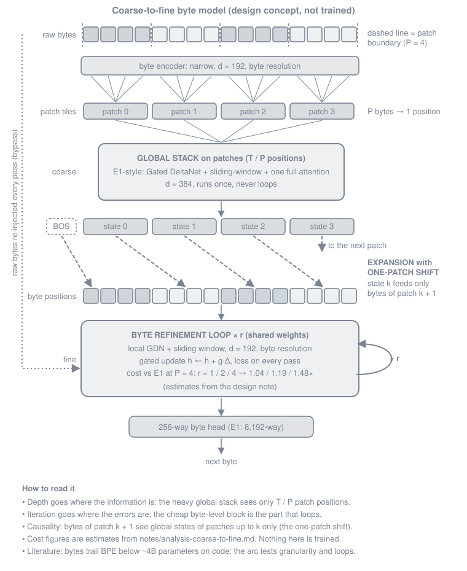

<p align="center">
  
</p>

<p align="center">
  <a href="LICENSE"></a>
  <a href="https://github.com/monstercameron/Gogeta-0/tags"></a>
  <a href="https://monstercameron.github.io/Gogeta-0/"></a>
  
  
  
</p>

<p align="center">
  <b>Quick links</b><br>
  <a href="https://monstercameron.github.io/Gogeta-0/">Site</a> ·
  <a href="https://monstercameron.github.io/Gogeta-0/devlog.html">Devlog page</a> ·
  <a href="https://monstercameron.github.io/Gogeta-0/learn.html">Learn</a> ·
  <a href="https://monstercameron.github.io/Gogeta-0/architecture.html">3D architecture</a> ·
  <a href="#byte-quest-bytes-are-a-main-quest-now">Byte Quest</a> ·
  <a href="experiments/INDEX.md">Experiment index</a> ·
  <a href="experiments/QUEUE.md">Queue</a> ·
  <a href="experiments/claims-status.md">Claims status</a> ·
  <a href="experiments/expenses.json">Expenses</a> ·
  <a href="notes/final-model-plan.md">Final model plan</a> ·
  <a href="DEVLOG.md">DEVLOG.md</a> ·
  <a href="https://github.com/monstercameron/Gogeta-0/tags">Releases / tags</a>
</p>

<p align="center">
  <b>Start here:</b> this README (the pitch and current status) → <a href="experiments/claims-status.md"><code>experiments/claims-status.md</code></a> (<b>the authoritative current state of every claim</b>; this README summarises it and may lag) → <a href="experiments/INDEX.md"><code>experiments/INDEX.md</code></a> (what each experiment asked and found) → <a href="experiments/QUEUE.md"><code>experiments/QUEUE.md</code></a> (what runs next) → <a href="DEVLOG.md"><code>DEVLOG.md</code></a> (versioned history).<br>
  <b>If the README and the ledger disagree, the ledger (<code>experiments/claims/</code>) wins.</b>
</p>

<p align="center">
  <b>Three efficiency tricks. One tiny language model. Fused, or it falls apart.</b><br>
  <a href="https://monstercameron.github.io/Gogeta-0/"><b>Project site</b></a> ·
  <a href="https://monstercameron.github.io/Gogeta-0/learn.html">Start here (plain English)</a> ·
  <a href="DEVLOG.md">Devlog</a> ·
  <a href="experiments/experiments.json">Experiments</a> ·
  <a href="notes/LABNOTEBOOK.md">Lab notebook</a> ·
  <a href="refs/README.md">Reading list</a>
</p>

---

**Gogeta-0** is a small causal language model for Python code, and the first model built on **FusionDance**: an architecture that fuses three separate answers to the three big costs of modern LLMs. It's an open, laptop-scale research project, and every experiment is written up honestly, failures included.

> **Status: v0.5.53. First models trained; the first headline did not survive.** The project is in an **assembly phase** (v0.5.0 onward): the 200M factorial shows the three ingredients' penalties compound, so compensations are tested one at a time on the full fusion (the A1 screen, E62; exploratory, two seeds, v0.5.4: ternary in the core only -8.3%, fixed r -5.2%, and a 6x2 loop shape -11.6%, which is a parameter-changed arm and not a compensation, all vs E27), and the assembled model (A2, E63, fresh seeds 2-4; a recipe-level comparison: loop policy, injection, precision scope and core shape all differ from E27) beat the full fusion by **16.7%** with about 1.6x its unique parameters (15.1M vs 9.5M non-embedding; not parameter-matched, SQ419 tests this: F-6 = A1g on seeds 2-4 at 200M, registered in v0.5.50 and running as GPU batch C1) (CI [-17.9, -15.5], exact t since v0.5.45; the first headline was not at matched FLOPs, since E27 uses about 10% less compute, v0.5.22; against a FLOP-matched E27 the gap is **16.2%**, CI [-16.9, -15.5], v0.5.30); its full-precision version is 0.9% below dense per FLOP in point estimate (v0.5.10; no equivalence test, so not a tie). On the human's instruction to keep every part, A3 (all parts, final in v0.5.17) found that every fix counts (ternary MoE core -3.3%, full-precision mixers -5.0%, full-precision FFN -5.2%, all parts -7.7% vs A2s), but the all-parts model still trails the unshared GDN hybrid by 4.4% and is not shown to tie dense (point estimate +1.1% vs E20, 90% CI [-0.13, +2.33]; C206-C208 are VERIFIED after the learning-rate bracket passed, v0.5.23). A4, the full stack with a coarse-to-fine byte decoder around the A3 backbone, is final (v0.5.20): the byte decoder costs +14.4% against the BPE head, so the registered viability rule fails (C210 and C211, both UNVERIFIED until the clean80 score, SQ387; v0.5.25). Self-speculative decoding is built but not lossless under int8 activations (v0.5.20). The reward-harness forgery is fixed for the probed routes (SQ373, v0.5.11), and SQ411 (v0.5.40) closes the `__eq__` route by AST-rewriting the tests in the grader (C83, PARTIAL: other routes stay open), so the harness-level GRPO block is lifted. Against the proper transformer control (E10, Hugging Face Llama at the same shapes) at tuned learning rates, swapping five of six attention layers for linear-time layers (E1) is 0.18% worse in the point estimate, not better, on the pre-registered clean-val metric (3 seeds each; the 95% CI spans zero, so no difference is detected; **ledger C5: REFUTED** by its registered rule, v0.4.78, qualified in v0.4.95). The earlier "3.6% lower loss" was against our own dense baseline E0, which turned out to be handicapped by 3.7% (E0-parity fails). The looped version **doesn't pay off yet** (C6/C7: partial). A 3-seed replication at the tuned learning rates (E10 3e-3, E1 6e-3, from the K7 sweep) ran on the N1X for six of its eleven items (E10 and E1, seeds 0–2). It is paused by an operator hold after a thermal kill at 86.6 °C (the partial E11 seed 0 run was discarded; DEVLOG v0.4.73). The 7-seed-per-arm replication on rented RTX 5090s (Phase 2b-5090, DEVLOG v0.4.74–v0.4.79) is done: E1 is **+0.08% vs E10** (paired 95% CI [−0.00087, +0.00132], p 0.64): no difference detected. Its sign matches the N1X test, but the CI spans zero. E11 (negative-eigenvalue Gated DeltaNet) is **equivalent to E1** within ±1% (C196, VERIFIED, 3 seeds, TOST p 0.002). Cloud (SQ220, `experiments/devlogs/SQ220.md`): the RTX 5090 is the fastest and cheapest card per token of the three we tried (C195, PARTIAL: one seed, 20M tokens, the 3090 and 5090 reproduce the N1X's loss within tolerance). A window sweep (SQ214, exploratory, 4 seeds) found E1's sliding window of 256 beats full context by 1.3%. The deduplicated **code-py-v2** dataset is built (v0.4.77: two machines produced byte-identical files; 71% of v1's train docs, 77% of its tokens), unblocking most of the A3 design; v2 validation is redrawn, so its numbers are not comparable with v1. Scale looks like the lever rather than loops: at E2's training FLOPs, 14 unshared blocks (E32, about 2.3× E1's unique parameters) reach about 7% lower clean80 bpc than E1 (C197, VERIFIED on 4 seeds at 200M; the lever is unique parameters, not depth, SQ282). The registered 2×2×2 factorial (F2: GDN × loops × ternary) looked mildly synergistic at 20M tokens (interaction −3.5%, C201), but at the registered 200M horizon it **reverses** (C202, PARTIAL: 3 seeds per cell): the ingredients' penalties compound (interaction **+6.21 log-points**, about +6.4% as a ratio; seed-blocked CI [+4.20, +8.22]; SQ263, C202). The interaction rises steadily through training, from −4.0% at step 250 to +4.5% at the last in-training eval (SQ337). At 200M, GDN alone is 4% better than dense per FLOP, but it takes 1.62× the dense wall time, so it is 8% worse at equal wall-clock (SQ338). Per-FLOP figures are analytic counts: sliding-window layers are counted at their window but run as a dense-masked T x T kernel (C12). Loops cost 10.6% (at matched FLOPs, looping also halves the unique parameters, 12.3M vs 27.9M, so this is partly the unique-parameter effect of C197), ternary 15.8%, and the full fusion is **30.8% worse** than dense. C201 is REFUTED by its own registered 200M check. The depth result (C197) now replicates on 4 seeds (SQ283: E32 beats E1 by 7.2% and the looped E2 by 12.2%; C197 VERIFIED). At each model's best learning rate, a 5-block model widened to the same parameters (E34) ties E32 (SQ282), so the lever is unique parameters at matched FLOPs, not depth as such; the earlier "E34 is 14% worse" was a learning-rate artifact. The deep stack does need its depth-scaled init (SQ308). The fleet waves 1–3b ran 106 training runs on eight rented RTX 5090s (0 failed runs) for **$6.54** (`experiments/expenses.json`, X4). The fleet is torn down (0 instances; the $30 GPU budget is spent: $30.13 in total, v0.4.103–v0.4.104). SQ243 and SQ241 (wave 4, 4 seeds each) are in: at d = 512 no E1–E10 difference is detected (+0.05%; not a registered equivalence), and at d = 256 E1 is better: 1.24% at the original LRs and 1.71% at each arm's best LR (SQ301, 2 seeds, LRs selected on the same seeds; C198 PARTIAL; the fresh-seed check SQ307 is inconclusive: −1.64%, all four seeds favour E1, but the CI [−3.66%, +0.43%] spans zero). Param-matched E1 is 0.61% worse than E10. SQ200 found our default init costs all-attention stacks about 3.5–3.8% while E1 shows no detected effect (C199 PARTIAL, fixed LRs); SQ308 (20M, 3 seeds) found the 14-block model's edge over E1 depends on the depth-scaled init: 2.6% better with it, no advantage with flat init (C197 limitation). The final model (goal 6) is planned as E61; its training needs the human's approval. The F2 factorial ran in two stages (the blinded seed-level sigma, 0.00873, set N_final at 221; per-run scores were visible during stage 1, disclosed in v0.4.89) and has been analysed: the 20M result (C201) and the 200M check (C202) are above. The recurrent decode kernel for Gated DeltaNet now works (C2 verified; the earlier NaN was our call-site bug, C110). **Caveat (K9, v0.4.33):** 41.7% of our validation documents turned out to be near-duplicates of training text, because the corpus repeats many problems, so every loss number so far is inflated. The clean80 metric drops only the 80%+ band: 1,159 of its 2,333 documents (49.7%) still have 50-79% overlap, so SQ410 reads every headline by overlap band. All loss numbers are provisional until the clean-validation re-score; all checkpoints will be re-scored on that cleaned set before any claim is settled. Since v0.5.21: `gogeta/hf.py` (the Hugging Face wrapper) could not build any model from v0.5.0 to v0.5.23; it is fixed in v0.5.24 and C80 is VERIFIED on saved output. A claim audit (v0.5.25) moved C210 and C211 to UNVERIFIED. Out of corpus (SQ379, v0.5.26), the ternary and loop costs of the assembled model shrink while the assembly gain survives; this is hypothesis C213 (PARTIAL since v0.5.38). Its registered replication SQ400 met all seven predictions on the 330-file SQ99 out-of-corpus set: the ternary cost is not distinguishable from 0 (+0.42% [-0.92, +1.77], n 6), and the loop cost reverses sign (A2f vs E24 -1.91% [-3.40, -0.40], C214, VERIFIED on that one set). The final model is therefore judged on out-of-corpus quality next to clean80. The v0.5.27 outside review registered SQ401 to SQ403 (dense capacity control for the MoE core, GDN write strength, eval-time pass count). GPU batch B1 (registered v0.5.31, amended through v0.5.35) ran on one rented RTX 5090 and was read out in v0.5.36 (20M tokens, exploratory, no ledger status changed): the MoE core matches a dense 2048-wide FFN at 31% fewer FLOPs (SQ401: no difference detected; no equivalence margin was set, so not a tie); a fixed GDN write strength costs under 0.5% in point estimate (SQ402, 2 seeds, no interval); a core learning-rate multiplier closes 9% of the loop cost, so the loop cost is not an LR artifact (SQ404); and unique parameters beat a second pass about 2.4x per FLOP (SQ350). No Holm gate opens. Total spend is $44.01 (v0.5.36). The assembly fleet is torn down ($13.09 for A1-A4, v0.5.30). See [Results](#results-so-far) and the [claims list](experiments/claims-status.md). **Early warning (SQ99, exploratory):** on Python from outside the training corpus we see no evidence of E1's in-corpus advantage (3.4% on our cleaned validation set): the out-of-corpus gap is +0.4% with a package-clustered 95% CI of −0.1% to +1.0%. The tuned, replicated checkpoints will be re-checked. A length re-analysis (C193, v0.4.66) adds: on short out-of-corpus files E1 keeps its ~3.9% advantage, on files over ~1,200 tokens it is ~1.1% worse, so the effect looks like long-context ability rather than corpus memorisation (length is confounded with file type; exploratory, n=1). The ledger marks C192 (transfer out of corpus) REFUTED under its registered pooled test, and C193 (the length effect) PARTIAL. And our dense baseline E0 itself trails the reference Llama (E10) by ~3.7% at identical shapes (possible init handicap, SQ200), so E1's headline lead over E0 may be largely a baseline artifact: Phase 2b compares E1 against E10. C16 (GDN recall vs plain linear attention) is INCONCLUSIVE: its K3 control failed the validity gate, and the check must be redesigned ([queue](experiments/QUEUE.md), Q15/Q16).

## The pitch

Modern LLMs are expensive along three separate axes, and the research community has a strong answer to each one *on its own*:

| | The cost | The fighter | The idea |
|---|---|---|---|
| ⚡ | **Context**: attention cost grows with the *square* of the text length | **Linear-time mixers** (Gated DeltaNet) + sliding-window attention | A fixed-size running memory instead of re-reading everything: linear time, constant memory (in principle; our sliding-window kernel still uses a dense mask, so it is O(n²) for now) |
| 🌀 | **Parameters**: more reasoning depth means more layers | **Looped depth** | Run one shared block *r* times: depth comes from compute, not weights |
| 🪶 | **Bits**: every weight stored in 16-bit precision | **Ternary weights** (BitNet b1.58) | Every weight is −1, 0 or +1: ~1.58 bits. With dedicated ternary kernels, matrix multiplies could become additions (ours are simulated, so no speedup yet) |

**FusionDance fuses all three, and Gogeta-0 is the first model to try it.** The bet is that they cover each other's weak spots. Linear-time mixers are weak at multi-step state tracking, and looping adds exactly that depth. Looping costs compute, and ternary weights could make compute cheap once real ternary kernels replace our floating-point simulation. The 200M result says the three penalties do not simply cancel: they compound ([C202](experiments/claims-status.md), PARTIAL). So the project is in an **assembly phase** (v0.5.0): we test one compensation at a time on the full fusion, and claim a stack only once it works.

## The architecture


**The one rule: nothing quadratic lives inside the loop.** Anything inside the loop is paid *r* times, so the only full-attention layer sits outside it and runs once. It's also the only layer whose memory grows with the length of the input.

The diagram above is the **token-level** model that E0–E11 train. A second, planned architecture, the **coarse-to-fine byte model**, keeps the same stack but changes *what* it runs on and *where* the loop sits: see [Byte Quest](#byte-quest-bytes-are-a-main-quest-now) below. It is a design concept, not a trained model.

## Byte Quest: bytes are a main quest now

<p align="center">
  
</p>

**Why bytes.** No tokenizer to train or ship; exact characters (identifiers, digits, indentation) instead of opaque token ids; robustness to odd spellings and unseen text; and an 8,192-way output head (21% of E1's per-token compute) replaced by a 256-way one.

**The coarse-to-fine idea: depth where the information is, iteration where the errors are.** A narrow byte encoder pools every *P* bytes into a patch. The E1-style global stack runs once, on patches only (1/*P* as many positions). Its output is shifted by **one patch** so a byte never sees its own patch's summary (the causal fix from MegaByte), expanded back to byte positions, and then a small **shared-weight byte refinement loop** runs *r* times at byte resolution, with the raw bytes re-injected each pass and a loss on every pass. The skeleton (encoder → global patches → decoder) is known work (MegaByte, BLT, H-Net); the hypothesis worth testing is the narrower one, that *shared* byte refinement beats an unshared decoder of equal FLOPs. Design: [`notes/analysis-coarse-to-fine.md`](notes/analysis-coarse-to-fine.md).

**Estimated cost** (estimates from that note, not measurements): at P = 4 the design costs about 1.04× / 1.19× / 1.48× E1's training FLOPs per token of text at r = 1 / 2 / 4, versus about 3.6× for a flat byte-level E1.

| Experiment | Question (E12 and E14-E16 planned, not run; E13 partly run, below) |
|---|---|
| [E12: flat byte-level E1](experiments/cards/E12.md) | Is a flat byte model (vocab 256, T = 4,096 bytes, E1's mixers) competitive with BPE-E1 at matched FLOPs and at matched bytes? |
| [E13: patch granularity sweep](experiments/cards/E13.md) | How does patch size (P = 2 / 4 / 8) trade quality against cost with a single-pass byte decoder? |
| [E14: byte refinement loop sweep](experiments/cards/E14.md) | At matched FLOPs, does a shared-weight refinement loop (r = 1 / 2 / 4, gated, per-pass loss) beat a single-pass decoder and an equal-FLOP unshared decoder? |
| [E15: parallel-then-refine decoding](experiments/cards/E15.md) | Can predicting all P bytes of the next patch at once and refining over r < P passes match byte-autoregressive quality? |
| [E16: byte quest × FusionDance](experiments/cards/E16.md) | Does the best byte decoder combine with a looped global core (E2-style) and a ternary global core? |

All five are registered (arc "Byte Quest (granularity x loops)" in [`experiments/experiments.json`](experiments/experiments.json)). Their predictions are registered in [`experiments/checks/PREDICTIONS.md`](experiments/checks/PREDICTIONS.md) (section "Registered Byte Quest predictions E12-E16", v0.4.68), and the 30 staged configs are bound to those predictions by hash (same file, v0.4.69). **First byte runs (v0.4.85, RTX 5090, 20M bytes, exploratory):** the SQ188 LR check picked lr 3e-3, and the E13 patch-size sweep at 20M bytes found P = 2 best (exploratory; matched bytes, not matched FLOPs). SQ374 (v0.5.15) then scored the existing E13a/E13b byte runs on clean80: fixed byte patches are far too costly (E13b +63% and E13a +36% bits per char vs E1; one seed each, no ledger claim).

**The honest caveat.** The literature says byte models trail BPE below roughly 4B parameters on code ([`notes/research-byte-level-2025-26.md`](notes/research-byte-level-2025-26.md)), so "beats BPE-E1" is *not* the claim. The arc's claims are about **granularity and loops**: how patch size trades quality for cost, and whether shared byte-level refinement buys anything over equal-FLOP unshared depth (E2's loop did not pay at token level, ledger C6). If all byte variants trail BPE but the loop beats its control, that is still a result.

Explore it: the [3D architecture page](https://monstercameron.github.io/Gogeta-0/architecture.html?model=c2f_byte) has a "C2F-byte (concept)" model with a patch-size slider and the loops slider; the [site section](https://monstercameron.github.io/Gogeta-0/#bytes) has the same diagram.

## Goals

1. **Fuse the three:** show that linear-time mixing, looped depth and ternary weights *stack* in one causal LLM.
2. **Think in loops, not out loud:** replace part of chain-of-thought with silent latent loops, spending compute instead of tokens and memory.
3. **The Rival Loop:** build critique → fix into the recurrence, with per-loop scoring, a grounded critic head, and adversarial damage-and-repair.
4. **Make loops pay at inference:** self-speculative decoding (draft with a few loops, verify with all of them, no extra model).
5. **Do it on a laptop:** small models, one-ingredient-at-a-time ablations, and results reported as *scaling shapes*: quality per bit, per FLOP, and cost vs context length.
6. **Ship it on a gaming GPU:** a final model, sized by our own scaling fit (primary target ~1.2B params), that runs with a KV/state cache and lossless speculative decoding on one 24 GB RTX 3090/4090 ([plan](notes/final-model-plan.md)).

## Results so far

200M tokens of Python each, seed 0, full validation split (contaminated: see K9; the registered verdicts use clean val). Lower loss is better.

| Experiment | Layout | Params (non-emb) | Val loss | vs E0 | Compute |
|---|---|---|---|---|---|
| [E0: dense baseline](experiments/writeups/E0.md) | 6 × full attention | 10.6M | 0.606 | n/a | 1.0× |
| [**E1: linear-time mixers**](experiments/writeups/E1.md) | 1 attention + 3 Gated DeltaNet + 2 sliding-window | 11.1M | **0.585** | **−3.6%** | 0.94× |
| E10: Llama control (the proper baseline) | 6 × full attention (Hugging Face Llama, same shapes) | 10.6M | 0.582 | −4.0% | 1.0× |
| [E2: looped core](experiments/writeups/E2.md) | `[SWA] → [GDN, GDN, SWA] × 4 → [attn]` | 9.5M | 0.619 | +2.0% | 2.0× |

**In plain English:**
- **Against the right control, the cheaper layers show no detected advantage.** E1 beat our E0 baseline, but E0 was handicapped: the Llama control E10 at the same shapes is 4% better than E0. In the registered 3-seed test at tuned learning rates, E1 is 0.18% worse than E10 in the point estimate on clean validation, with a CI that spans zero (C5: REFUTED by its registered rule, v0.4.78, qualified in v0.4.95). The 7-seed replication on rented RTX 5090s is done: E1 is +0.08% vs E10, no difference detected.
- **Loops don't pay yet (C6, PARTIAL).** The looped model was 2% worse at twice the cost. On the 5090s, E2 is 2.6% worse than its unlooped twin E9 (one seed each, descriptive; C6 is PARTIAL, not established).
- **Scale, so far.** At matched FLOPs, a 14-block unshared stack with about 2.3× the unique parameters beats E1 by about 7% on four seeds at 200M (C197, VERIFIED). SQ243/SQ241/SQ301 test the width axis: no difference detected at d = 512, E1 1.2–1.7% better at d = 256 (C198, PARTIAL), and param-matched E1 0.61% worse than E10.
- **The fusion does not stack at 200M (C202, PARTIAL).** The registered 2×2×2 factorial (GDN × loops × ternary) has overlapping penalties at 20M but compounding ones at 200M: interaction +6.21 log-points (seed-blocked CI [+4.20, +8.22]), so the full fusion is 30.8% worse than dense while GDN alone is 4% better per FLOP. C202 is PARTIAL (3 seeds per cell; learning-rate coverage at 200M is incomplete for two cells, SQ342).
- **The assembled model beats the full fusion (A2, E63; C209, VERIFIED at recipe level: fresh seeds 2-4, 200M tokens).** The assembled recipe (prelude attention, a shared 6-block core run twice with ternary blocks and contractive injection, coda attention) has 16.7% lower clean80 bits per char than the full fusion, with about 1.6x its unique non-embedding parameters (15.1M vs 9.5M; not parameter-matched, SQ419 is the control) (95% CI [-17.9, -15.5]; exact t quantile, v0.5.45) and is 8.6% above dense per FLOP. Its full-precision version is 0.9% below dense per FLOP in point estimate (n = 3; no equivalence test and no ledger claim, so not a tie). Two costs remain: ternary (+9.5% inside the stack) and loops (+3.2% vs the unshared GDN stack, A2f vs E24, 3 seeds). This is a recipe-level result, not a mechanism claim (v0.5.10). Its headline holds at matched FLOPs: against a FLOP-matched E27 (seeds 2-4, 221.6M tokens) it is -16.18% [-16.87, -15.48] (v0.5.30). The first headline was not at matched FLOPs (erratum, v0.5.22). Out of corpus (SQ400, v0.5.38, registered), the ternary cost is not distinguishable from 0 (+0.42% [-0.92, +1.77]) and the loop cost reverses sign (A2f vs E24 -1.91% [-3.40, -0.40]; C214, VERIFIED on that one out-of-corpus set), while the 11% assembly gain survives; that is hypothesis C213 (PARTIAL).
- **All-parts model and full stack (A3, A4; v0.5.17 and v0.5.20).** On fresh seeds 5-7 every A3 fix counts, but the all-parts model (C208, VERIFIED) trails the unshared GDN hybrid by 4.4% and is not shown to tie dense E20 (+1.1%, 90% CI [-0.13, +2.33]); its learning rate is now bracketed (v0.5.23). The tokens-as-patches byte decoder on that backbone (A4, C210 and C211, UNVERIFIED until the clean80 score, SQ387) costs +14.4% in nats per token against the BPE head, so the full stack is not viable yet; the design-around is registered as SQ394. Self-speculative decoding works but is not lossless under int8 activations (v0.5.20).
- **Long context (SQ351, exploratory: 3 seeds, 153 long out-of-corpus files; no ledger claim yet).** Beyond the 1,024-token training length, the GDN hybrid's loss is -60.7% vs dense (95% CI [-69.8, -51.5]), while dense degrades by +160% past its window. This is the first measured, not analytic, evidence for the linear-time pillar.
- **Fixed vs random loop depth (A1 amendment 2, C212, PARTIAL).** Training the shared loop at fixed r = 4 beats random r with full backprop by 3.2% (paired 95% CI [-3.7, -2.6], 3 seeds). Seeds 0-1 both chose and tested the fixed arm, so the fresh seed alone gives -3.1% (v0.5.33).
- **Copying (SQ347, registered; prediction not met).** Beyond the sliding window, the GDN cells copy far worse than dense (+32% and +37% at gap 256), and the interaction's confidence intervals include 0 at gaps 256 and 512. The assembled model needs a fix for this; the planned one is more full attention outside the loop (SQ383, v0.5.13).
- **Our best guess at why (not yet settled; C7 partial, one checkpoint).** Tested with 1–12 loops, it does best at 4, the average it was trained with, and gets *worse* beyond the trained range. It learned a routine, not "more thinking = better", which is what the Rival Loop is designed to fix.
- **Not confirmed yet:** each result is a single seed or a single-SKU replication. The registered confirmatory test is still the N1X one (Q12), and the unlooped control ([E9](experiments/writeups/E9.md)) has one 5090 seed.

Every experiment has a page with interactive charts and a plain-English explainer on the **[project site](https://monstercameron.github.io/Gogeta-0/)**, e.g. [E2: why the loop disappoints](https://monstercameron.github.io/Gogeta-0/experiments/E2.html). The **[full roadmap](experiments/experiments.json)** runs E0 → E9: ternary weights, the full fusion (→ `v1.0.0`), adaptive loops, the Rival Loop, loops vs chain-of-thought, and self-speculative decoding.

## Run report forms

A **run report form** is a one-page report for a single finished training run: what the experiment asked and predicted, the architecture and hyperparameters, the commit and environment, the final metrics, a visible data caveat (K9: the validation split is inflated), the related claims in the ledger, and graphs (loss, learning rate, gradient norm, throughput, and a comparison with sibling runs). The cockpit fills the facts; an agent writes the narrative (purpose, what happened, comparison with siblings, verdict, follow-ups) and every field is tagged as machine-filled or agent-written.

- **Where they live:** [`experiments/run-forms/INDEX.md`](experiments/run-forms/INDEX.md) lists every run with its form; each form is `experiments/run-forms/<run_id>.md` with its SVG charts in `experiments/run-forms/<run_id>/`.
- **How an agent fills one:** call the cockpit MCP tool `gogeta_run_form_draft` with the run id, read the auto-filled draft and the evidence it links, write the narrative fields, then call `gogeta_run_form_submit` (it refuses empty narrative fields and any ledger claim without an evidence pointer). `gogeta_brief` lists finished runs that still lack a form.
- **How a human views or creates one:** start the cockpit with `bash cockpit/cockpit.sh`, open the **Runs** tab (`h`), press **Run forms** to see every run as none / draft / filled, and **Draft form** to start one. Details: [`cockpit/README.md`](cockpit/README.md), "Run forms".
- **The rule:** every finished run gets a form.

## Quick start

Tested on Ubuntu 24.04 under WSL2 with an NVIDIA Blackwell GPU (ARM64). Any recent CUDA GPU that runs Triton should work.

**No GPU or data download needed for a first check:** after step 1, `CUDA_VISIBLE_DEVICES= python -m unittest tests.test_options tests.test_moe` builds and trains tiny FusionDance models on synthetic tokens on CPU, checking bit-identical defaults, causality and the MoE option (28 tests, about 10 s; 1 GDN test is skipped without a GPU).

**Start reading here:** the status paragraph at the top. The three results that define the project so far are:
- the hybrid shows no detected advantage over a tuned Llama control (C5);
- more unique parameters at matched FLOPs beat loops (C197);
- the fusion ingredients' penalties overlap at 20M but compound at 200M (C201 is REFUTED by its registered 200M check; C202 is PARTIAL).

### Where we are, in plain words

F2 is the registered 2×2×2 test of three ingredients: a Gated DeltaNet (linear-time) mixer, shared looped layers, and ternary weights, each switched on or off at matched compute. The clean80 and clean50 scores are validation subsets whose documents overlap little with the training data, so they are the numbers we trust most (our original validation split was 41.7% near-duplicates, K9). At 200M tokens the three penalties compound rather than cancel: the full fusion is 30.8% worse than dense, with an interaction of +6.2 log-points ([C202](experiments/claims-status.md), PARTIAL: 3 seeds per cell, and some learning-rate coverage is still missing, [SQ342](experiments/side-quests.md)). A feed-forward test (E60, C203) finds that a mixture-of-experts layer beats the E1 hybrid by 2.7%, and a plain dense wider layer beats it by 4.2% at about twice the feed-forward compute. The project is now in its full-stack phase (v0.5.12): the A1 screen (E62) has tested one compensation at a time on the full fusion (such as a fixed loop count or contractive loop injection), with exploratory results in v0.5.4; the assembled model (A2, E63) beat the full fusion by 16.7% on fresh seeds and its full-precision version is 0.9% below dense in point estimate (v0.5.10; not an equivalence test). A3 (all parts, final in v0.5.17) found that every fix counts, but the all-parts model still trails the unshared GDN hybrid by 4.4% (C208, VERIFIED). A4, the full stack with coarse-to-fine bytes around the A3 backbone, is final (v0.5.20): the byte decoder costs +14.4% (C210, UNVERIFIED until the clean80 score, SQ387), so the full stack is not viable yet. Self-speculative decoding is built but not lossless under int8 activations (v0.5.20). Predictions and winner rules are registered in [PREDICTIONS.md](experiments/checks/PREDICTIONS.md).

### How to follow one result

Worked example: [C209](experiments/claims/views/C209.md), the claim that the assembled model A2s beats the full fusion E27 by 16.7% at 200M tokens (VERIFIED at recipe level, not parameter-matched).

- **The claim's ledger view:** [`experiments/claims/views/C209.md`](experiments/claims/views/C209.md). It is generated from the append-only ledger (`experiments/claims/ledger/C209.jsonl`) and shows the definition, the current status, the limitations and every event.
- **The evidence:** [`experiments/checks/results/a2_assembled.json`](experiments/checks/results/a2_assembled.json) has the paired per-seed numbers and the 95% intervals. The FLOP-matched figure (-16.2%, against E27 trained on 221.6M tokens) is in [`experiments/checks/results/a2_compute_matched.json`](experiments/checks/results/a2_compute_matched.json).
- **The registration:** the predictions and pass criteria were written before the runs, in [`experiments/checks/PREDICTIONS.md`](experiments/checks/PREDICTIONS.md), section "A2 assembled model", with the compute match in "A2 amendment 3".
- **The control for the parameter confound:** C209 is not parameter-matched (about 15.1M vs 9.5M unique parameters). GPU batch C1 (registered v0.5.50, amended v0.5.51; section "GPU batch C1" in the same file) runs F-6, E27's recipe on A2s's 6-block core, on fresh seeds 2-4 at 200M tokens. Its readout is [`experiments/checks/sq419_f6.py`](experiments/checks/sq419_f6.py).
- **The queue:** [`experiments/QUEUE.md`](experiments/QUEUE.md), item 48 (SQ419), currently RUNNING.

### Glossary

- **A1 / A2 / A3 / A4:** assembly stages. A1 is the one-change screen (one compensation at a time on the full fusion, E62, two seeds). A2 is the stacked assembled model on fresh seeds, against dense and GDN references (E63). A3 is the all-parts model on fresh seeds 5-7 (registered v0.5.10): a ternary MoE FFN in the shared core, plus full-precision mixers or FFN to locate ternary's cost. A4 is the full stack, registered in v0.5.15 and final in v0.5.20: coarse-to-fine bytes (tokens as patches) around the A3 backbone, with a shared-weight byte refinement loop and an unshared single-pass decoder as a parameter-matched control (v0.5.12).
- **E-numbers:** registered experiments (E0 to E63), each with a row in [`experiments/INDEX.md`](experiments/INDEX.md).
- **F2 cells 000 to 111:** the registered 2×2×2 factorial of GDN mixer × shared loops × ternary weights, one digit per ingredient (1 = on). 000 is the all-off base and 111 is the full fusion.
- **clean80 / clean50:** validation documents with under 80% (clean80, the primary metric) or under 50% (clean50) of their 13-grams in the training data.
- **Matched FLOPs:** arms compared at equal analytic training FLOPs per token. Equal wall-clock is a separate check (SQ338, v0.4.104).
- **Parameter-changed arm:** an arm that changes the unique parameter count (such as A1g's 6×2 loop shape). It is read against C197's parameter lever, not as a compensation.
- **Log-points:** 100 × the natural-log ratio of two losses. +6.21 log-points is +6.4% as a ratio (v0.4.104).
- **What A2 can claim:** a recipe-level claim (the assembled recipe vs the full fusion and vs dense), not a claim about which ingredient causes the gain. Mechanism claims need the factorials and the A3 ladder (v0.5.6).
- **Statuses:** VERIFIED means the registered criteria were met on saved output. PARTIAL means some evidence, but not all criteria. UNVERIFIED means no saved-output evidence yet. It does NOT mean "probably true".

```bash
# 1. Environment (Triton needs the Python headers)
sudo apt-get install -y python3.12-venv python3.12-dev
python3 -m venv ~/.venvs/gogeta && source ~/.venvs/gogeta/bin/activate
pip install torch --index-url https://download.pytorch.org/whl/cu130
pip install -e .

# 2. Check the GPU kernels and the model
python tests/test_gdn_kernels.py
python tests/test_model.py

# 3. Build the dataset (downloads ~2.8 GB; Python-only subset, ~262M tokens)
python tools/prepare_data.py

# 4. Train and watch it in the local dashboard (configs/ has E0/E1/E2/E9; experiments/staged-configs/a3/ has the assembled models)
python -m gogeta.train --config configs/e1_hybrid.json --compile
python -m gogeta.train --config experiments/staged-configs/a3/a3mx.json --compile
python tools/dashboard.py          # http://127.0.0.1:7861

# 5. Rebuild the project site after recording results
python tools/build_site_data.py
python -m http.server 8791 --directory docs
```

Data, checkpoints and run logs go to `~/fusiondance-data/` (set `GOGETA_DATA` to change it), never into the repo. Tracking is fully local ([Trackio](https://huggingface.co/docs/trackio)); nothing is uploaded.

## Repository layout

```
gogeta/              the package: model.py (FusionDance), train.py, tracking.py, assets/ (tokenizer)
configs/             one JSON config per experiment
tests/               GPU kernel check against a reference + model correctness tests
tools/               data pipeline, run queue, result recorder, dashboard, site builder
experiments/         experiments.json (registry: predictions, status, results),
                     writeups/ (per-experiment explainers), curves/ (eval curves)
docs/                the GitHub Pages site (landing, devlog, primer, a page per experiment)
site-src/            source for the "Start here" primer
notes/               LABNOTEBOOK.md (timestamped evidence) + sketch.md (design scratchpad)
refs/                55-paper reading list + fetch script (PDFs are not committed)
DEVLOG.md            versioned history: every entry is a commit and a git tag
AGENTS.md            working rules for humans and AI agents in this repo
```

## How the research is run

- **Predictions first.** Every experiment's prediction is committed *before* it runs, then scored hit/miss afterwards.
- **One ingredient at a time**, so a failed fusion can be traced to a specific change.
- **Provenance.** Every run records its git commit, config and seed, and runs for a release refuse to start on uncommitted code.
- **Devlog = commits = versions.** Each entry in [`DEVLOG.md`](DEVLOG.md) is exactly one commit and one semver tag (`0.y.z` until the full fusion works).
- **Everything explained twice:** a detailed breakdown for researchers, and a plain-English section for everyone else.

Full rules are in [`AGENTS.md`](AGENTS.md).

## Project site

Live at **[https://monstercameron.github.io/Gogeta-0/](https://monstercameron.github.io/Gogeta-0/)**. GitHub Pages deploys it straight from `main` / `docs` on every push; it's static, so there's no build step on GitHub. Regenerate it locally with `python tools/build_site_data.py` before committing. Every version is a git tag ([all tags](https://github.com/monstercameron/Gogeta-0/tags)).

## Standing on the shoulders of

BitNet b1.58, Mamba / Mamba-2, Gated DeltaNet, Kimi Linear, Samba, Zamba, Universal Transformers, Recurrent Depth (Huginn), Mixture-of-Recursions, TRM / HRM, LayerSkip, DFlash, and more: 55 papers with notes in [`refs/README.md`](refs/README.md). The closest prior work we know of, a TRM-style recursive Mamba-2/attention hybrid, is flagged there. FusionDance's bet is the *full* fusion, ternary included, aimed at a general causal LLM.

**Credits**
- **Training data:** [OpenCoder-LLM/opc-annealing-corpus](https://huggingface.co/datasets/OpenCoder-LLM/opc-annealing-corpus) (`algorithmic_corpus` + `synthetic_code_snippet`, Python only), licensed under **ODC-By 1.0**. The tokenizer in `gogeta/assets/` was trained on it. The data itself is not redistributed here.
- **Kernels:** [flash-linear-attention](https://github.com/fla-org/flash-linear-attention) (Gated DeltaNet chunk kernel). **Tracking:** [Trackio](https://huggingface.co/docs/trackio). **Framework:** PyTorch.

## License

Code and documentation: [MIT](LICENSE). The dataset keeps its own license (ODC-By 1.0); paper PDFs are fetched from arXiv and not redistributed.

---

<sub>*The name is a fan homage to a certain two-person fusion dance: two fighters become one stronger one, but only if the dance is perfectly in sync. This is an independent research project, not affiliated with or endorsed by the Dragon Ball rights holders.*</sub>
