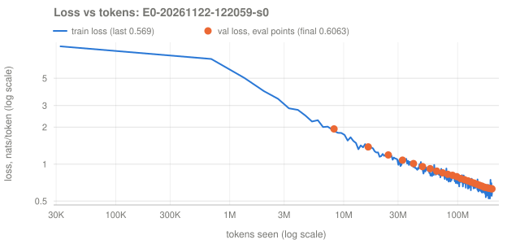
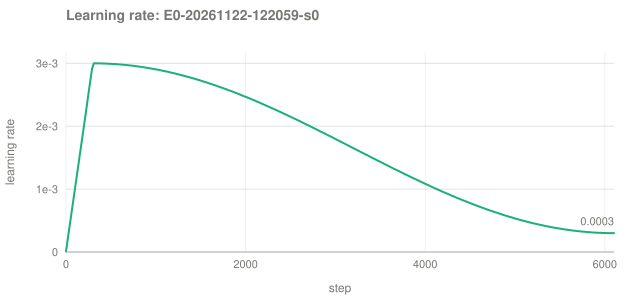
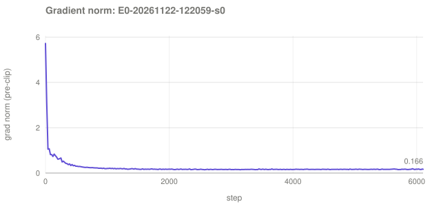
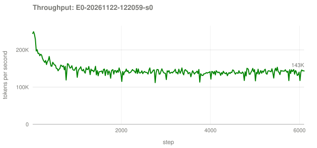
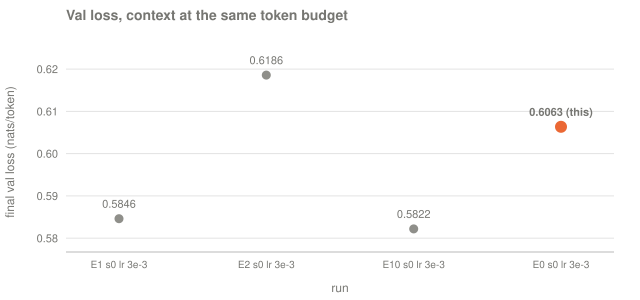

# Run report: E0-20261122-122059-s0

> Form status: **filled** by claude (run-form agent via gogeta-cockpit MCP) at 2026-11-22T18:41:18. Fields tagged `[machine]` were filled by the cockpit from run artifacts; fields tagged `[agent]` were written by the agent from the cited evidence. Generated by `cockpit/runform.py` (`gogeta_run_form_draft` then `gogeta_run_form_submit`).

> **Data caveat (K9) [machine].** K9 (experiments/cards/K9.md, v0.4.33) found the val split is 41.7% near-duplicates of train (1,667 of 4,000 val docs have >= 80% of their 13-grams in train). Every training-time val loss and bits/char below is inflated; comparisons may be confounded if architectures memorise repeats differently. A clean-val doc-level re-score is pending. See [`experiments/cards/K9.md`](../cards/K9.md); ledger C94, C107, C131.

> Clean-val score: **not yet available** (pending). Until it exists, read every val number on this page as inflated.

## 1. Identity and experiment

| Field | Value | Filled by |
|---|---|---|
| Run id | `E0-20261122-122059-s0` | machine |
| Experiment | E0: Dense transformer baseline | machine |
| Arc | Base Form | machine |
| Registry status / version | done / v0.3.0 | machine |
| Seed | 0 | machine |
| Question | What does a plain ~10M-param causal transformer reach on TinyStories at our compute budget? Every later arc is measured against this. | machine |
| Prediction (as registered) | Written 2026-11-22 before the run. After 200M tokens of Python (code-py-v1), full-val loss lands in 0.90-1.30 nats/token (about 0.35-0.50 bits/char). Throughput about 170k tok/s compiled, about 20 min. Samples are syntactically plausible Python with coherent short functions but frequent logic errors. | machine |
| Config file | `configs/e0_dense.json` | machine |

## 2. Architecture

| Field | Value | Filled by |
|---|---|---|
| Summary | FusionDance d=384, 6 heads, MLP 1024, window 256; prelude ['attn', 'attn', 'attn', 'attn', 'attn', 'attn'], core [], coda []; loops r=4 (train range 1-7), ternary=False | machine |
| Parameters total / non-embedding | 13,767,552 / 10,621,824 | machine |
| FLOPs per token (train, default loops) | 96,758,784 | machine |
| Loops r | 4 | machine |
| Source | meta.json config.params / config.model (recorded by gogeta.train from param_counts() and flops_per_token()) | machine |

## 3. Hyperparameters

| Field | Value | Filled by |
|---|---|---|
| Peak lr | 0.003 | machine |
| Schedule | linear warmup then cosine to min_lr_frac x lr (gogeta/train.py:132-136; formula, not logged per run) | machine |
| Warmup steps / min_lr_frac | 300 / 0.1 | machine |
| Batch x seq len (tokens/step) | 32 x 1024 (32,768) | machine |
| Token budget / tokens trained / steps | 200,000,000 / 200,015,872 / 6104 | machine |
| Optimiser | AdamW betas [0.9, 0.95], weight decay 0.1, grad clip 1.0 | machine |
| Eval | every 250 steps on 128 sequences | machine |
| Dataset | code-py-v1 | machine |
| Precision / compile | bf16 autocast (gogeta/train.py:144; not logged per run) / compile=True | machine |
| Seed | 0 | machine |

## 4. Provenance and environment

| Field | Value | Filled by |
|---|---|---|
| Commit | `0dc74914c541a281c06d0bdbd38eba5b1b2525a9` | machine |
| Version tag (git describe) | `v0.2.0-1-g0dc7491` (dirty=False, code_dirty=False) | machine |
| CLI overrides | not recorded | machine |
| Command | not recorded | machine |
| Campaign / item | none (launched directly or by run_queue.sh)  | machine |
| Training log | `e0_dense.log` | machine |
| Torch / GPU / driver | not recorded / not recorded per run (host GPU now: NVIDIA RTX Spark N1X (6144-core Blackwell RTX GPU), 621.24) / not recorded per run | machine |
| Launcher env | not recorded | machine |
| Peak GPU memory (GB) | 4.75 | machine |

## 5. Timing and status

| Field | Value | Filled by |
|---|---|---|
| Started / finished | 2026-11-22T12:21:02 / 2026-11-22T12:44:32 | machine |
| Wall time (min) | 23.30 | machine |
| Throughput (tokens/s, average) | 143,083 | machine |
| Status / exit code | done / None | machine |
| FLOPs total | 1.935e+16 | machine |

## 6. Results (training-time val: inflated, see the caveat)

| Field | Value | Filled by |
|---|---|---|
| Final val loss (nats/token) | 0.6063 | machine |
| Final val bits/char | 0.2351 | machine |
| Train loss, last logged / mean of last 5 | 0.5695 / 0.5836 | machine |
| Best periodic val loss, 128-seq eval (step) | 0.6288 (step 6103) | machine |
| Tokens to reach within 10% of the last periodic val | 147,488,768 | machine |
| Max grad norm after warmup | 0.485 | machine |
| Train-loss jumps > 0.5 after warmup | [] | machine |
| Reached token budget | True | machine |
| Series source | trackio:gogeta-0.db (612 train, 25 val points) | machine |

## 7. Siblings

Finished runs of E0 at the same token budget [machine]:

| Run | Seed | Peak lr | Val loss | Val bits/char | |
|---|---|---|---|---|---|
| `E0-20261122-122059-s0` | 0 | 0.003 | 0.6063 | 0.2351 | **this run** |

Context, other experiments at the same token budget [machine]: E1 s0 lr 0.003 val 0.5846; E2 s0 lr 0.003 val 0.6186; E10 s0 lr 0.003 val 0.5822

## 8. Related ledger claims [machine]

Latest status per claim from `experiments/claims.md` (append-only ledger; last row wins).

| Claim | Status | Statement |
|---|---|---|
| [C5](../claims.md#L253) | PARTIAL (pending clean-val re-score, K9) | The hybrid stack (E1) beats dense attention (E0) at 14M params / 200M tokens of Python |
| [C6](../claims.md#L254) | PARTIAL | Looping E2's core does not beat E0/E1 at ~2x the compute |
| [C90](../claims.md#L134) | VERIFIED (computed) | Hugging Face's `LlamaForCausalLM` at E0's shapes (E10) has exactly E0's parameter count (13,767,552 total / 10,621,824 non-embedding) and analytic train FLOPs (96,758,784 per token at seq 1024) |
| [C95](../claims.md#L272) | VERIFIED | E1 vs E0 is matched tokens, near-matched params, not matched compute |
| [C101](../claims.md#L181) | VERIFIED (E0, one checkpoint) | lm-eval's per-document val bpc is **6.1% lower** than train.py's packed val bpc (E0: 0.2208 vs 0.2351), and the gap is the protocol (packed windows start mid-document), not a wiring error |
| [C119](../claims.md#L219) | UNVERIFIED | E0's compiled step is memory-bandwidth/elementwise-bound, not compute- or launch-bound (matmuls < 55% of GPU time; GPU busy >= 90% of wall time) |
| [C124](../claims.md#L224) | UNVERIFIED | The batch path (`TokenData.batch`: numpy gather, int64, pin_memory, H2D) costs < 3% of an E0 step; a GPU-resident dataset gives bit-identical batches |
| [C8](../claims.md#L256) | VERIFIED | Our models compress held-out Python to ~3% vs xz/gzip |
| [C91](../claims.md#L135) | PARTIAL | Adding `"arch": "hf_llama"` to `gogeta/train.py` leaves FusionDance training unchanged |
| [C94](../claims.md#L241) | REFUTED (leakage present) | Our ~0.23 bits/char on held-out Python is plausible for this corpus (not a bug or train/val leakage) |
| [C102](../claims.md#L182) | UNVERIFIED (reported; we have not run HumanEval on a trained checkpoint) | HumanEval pass@1 floors at our size: Codex-12M 2.00% (pass@100 8.58%) after 100B tokens, PolyCoder-160M 2.13%, CodeParrot-110M 3.80%; one problem = 0.61 pts, so variants ≲ 5 problems apart can't be told apart |
| [C103](../claims.md#L183) | VERIFIED (line-match screen; a lower bound, misses paraphrases) | Our training data contains HumanEval/MBPP material: 32/164 HumanEval problems have ≥ 50% of their ≥ 40-char docstring/solution lines verbatim in `docs_train.jsonl` (43/164 with ≥ 2 lines); 43/500 MBPP test statements app |

## 9. Narrative [agent]

Written by **claude (run-form agent via gogeta-cockpit MCP)** at 2026-11-22T18:41:18 from the evidence in sections 1-8 and the links below.

**Purpose** [agent]

Dense-transformer baseline of the ladder (E0): a plain ~10.6M-non-embedding causal transformer trained for 200M tokens of Python (code-py-v1), the yardstick every later arc is compared with (experiments/cards/E0.md).

**What happened** [agent]

Ran to completion in 23.3 min, 6,104 steps, 143k tokens/s average, 4.75 GB peak, no loss jump above 0.5 after warmup. It was launched through the deprecated tools/run_queue.sh together with E1 and E2, so there is no campaign id and the exit code is not recorded in the run folder. Registered prediction (val 0.90-1.30) was missed: it landed at 0.6063, because the curated corpus is far more predictable than assumed (experiments/devlogs/E0.md). Max logged grad norm after step 300 is 0.485 by the cockpit's recomputation from Trackio; the micro devlog says 0.38, a discrepancy I did not resolve. Seeds 1-2 never ran (killed at 15:28) and the queued re-run at the tuned LR was closed because 3e-3 equals the E10 tuned LR.

**Comparison with siblings** [agent]

No other E0 runs. Context at the same 200M-token budget and the same lr 3e-3: E1 0.5846 (-3.6% vs E0), E2 0.6186 (+2.0%), E10 seed 0 (HF Llama at E0's shapes) 0.5822 (-4.0%). E10 and E0 have identical parameter counts and FLOPs per token, so the 4% gap to a library implementation at the same shapes is worth chasing.

**Verdict** [agent]

Reference arm for C5 (does the hybrid beat dense attention?): it informs, because E1 is -3.6% vs this run at matched tokens, single seed. It also supports C95: E0 has 10.62M non-embedding params and 96.76M FLOPs/token versus E1's 11.09M (+4.4%) and 91.03M (-6%), so E1 vs E0 is matched tokens and near-matched params, not matched compute. Val numbers are K9-inflated and one seed only.

**Follow-ups** [agent]

Clean-val doc-level re-score of this checkpoint (K9 consequence; K8 reported 0.2209 doc-level vs 0.2351 training-time). Investigate why HF Llama at E0's shapes beats E0 by 4% in E10 seed 0 (init, RoPE layout, eps). Seeds 1-2 of E0 were never run.

**Claims this run counts toward** [agent]

| Claim | Effect | Evidence pointer |
|---|---|---|
| C5 (PARTIAL (pending clean-val re-score, K9)) | informs | experiments/devlogs/E0.md, run E0-20261122-122059-s0 at v0.3.0 |
| C95 (VERIFIED) | supports | experiments/cards/E0.md and run E0-20261122-122059-s0 at v0.3.0 (params and FLOPs in the form above) |

## 10. Graphs [machine]

Skipped charts (data not recorded): loops: not a looped run (no val_loss_r<k> metrics)

## 11. Links [machine]

- Experiment card: [`experiments/cards/E0.md`](../../experiments/cards/E0.md)
- Micro devlog: [`experiments/devlogs/E0.md`](../../experiments/devlogs/E0.md)
- Related: [`experiments/devlogs/EVAL-SUITE.md`](../../experiments/devlogs/EVAL-SUITE.md)
- Related: [`experiments/devlogs/K8.md`](../../experiments/devlogs/K8.md)
- Related: [`experiments/devlogs/_proposed-evidence-rows.md`](../../experiments/devlogs/_proposed-evidence-rows.md)
- Related: [`experiments/checks/results/K8.json`](../../experiments/checks/results/K8.json)
- Related: [`experiments/checks/results/K9.json`](../../experiments/checks/results/K9.json)
- Related: [`evals/results/battery-smoke-E0-limit150-tier1-20261122-183529.json`](../../evals/results/battery-smoke-E0-limit150-tier1-20261122-183529.json)
- Related: [`evals/results/check-E0-s0-cruxeval-samples-tier1-20261122-172837.json`](../../evals/results/check-E0-s0-cruxeval-samples-tier1-20261122-172837.json)
- Related: [`evals/results/check-E0-s0-exec-limit8-tier1-20261122-172825.json`](../../evals/results/check-E0-s0-exec-limit8-tier1-20261122-172825.json)
- Related: [`evals/results/check-E0-s0-tier1ll-tier3-tier1-20261122-172441.json`](../../evals/results/check-E0-s0-tier1ll-tier3-tier1-20261122-172441.json)
- Related: [`evals/results/check-E0-s0-valbpb-full-tier1-20261122-171816.json`](../../evals/results/check-E0-s0-valbpb-full-tier1-20261122-171816.json)
- Related: [`evals/results/check-packed-vs-doc-E0-20261122-122059-s0.json`](../../evals/results/check-packed-vs-doc-E0-20261122-122059-s0.json)
- K9 caveat card: [`experiments/cards/K9.md`](../cards/K9.md)
- Trackio: http://127.0.0.1:7861 (project gogeta-0, run E0-20261122-122059-s0)
- Ledger: [`experiments/claims.md`](../claims.md), [`experiments/claims-status.md`](../claims-status.md)
