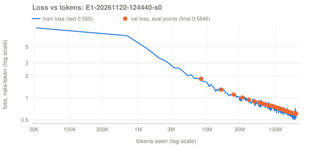
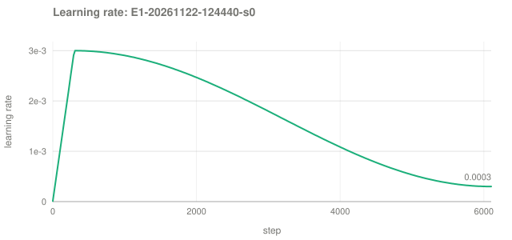
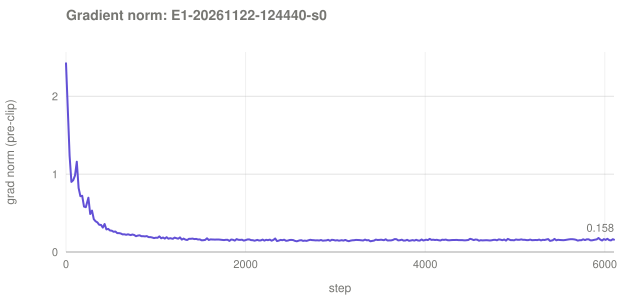
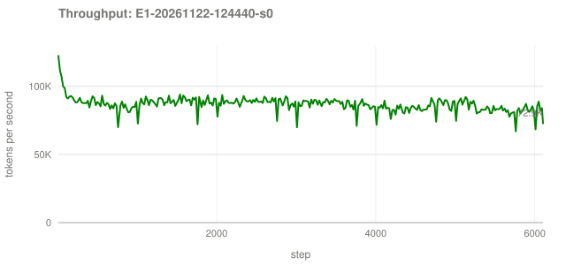
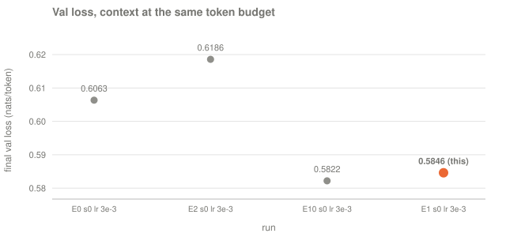

# Run report: E1-20261122-124440-s0

> Form status: **filled** by claude (run-form agent via gogeta-cockpit MCP) at 2026-11-22T18:41:19. Fields tagged `[machine]` were filled by the cockpit from run artifacts; fields tagged `[agent]` were written by the agent from the cited evidence. Generated by `cockpit/runform.py` (`gogeta_run_form_draft` then `gogeta_run_form_submit`).

> **Data caveat (K9) [machine].** K9 (experiments/cards/K9.md, v0.4.33) found the val split is 41.7% near-duplicates of train (1,667 of 4,000 val docs have >= 80% of their 13-grams in train). Every training-time val loss and bits/char below is inflated; comparisons may be confounded if architectures memorise repeats differently. A clean-val doc-level re-score is pending. See [`experiments/cards/K9.md`](../cards/K9.md); ledger C94, C107, C131.

> Clean-val score: **not yet available** (pending). Until it exists, read every val number on this page as inflated.

## 1. Identity and experiment

| Field | Value | Filled by |
|---|---|---|
| Run id | `E1-20261122-124440-s0` | machine |
| Experiment | E1: Linear-time mixers | machine |
| Arc | Ki Control | machine |
| Registry status / version | done / v0.3.0 | machine |
| Seed | 0 | machine |
| Question | Can Gated DeltaNet (vs Mamba-2 vs sliding-window only) plus one global attention layer match the baseline, while memory stops growing with context? | machine |
| Prediction (as registered) | Written 2026-11-22 before the run. Same depth, about the same params as E0, but only one full-attention layer. Val loss within +-2% of E0 and more likely slightly better (hybrids tend to win at short context; the 100-step bench was already lower: 2.58 vs 2.84). About 1.7x slower wall-clock than E0 because of the GDN kernels (100k vs 173k tok/s). If it is worse than E0 by >3%, suspect the GDN parametrisation or the SWA window. | machine |
| Config file | `configs/e1_hybrid.json` | machine |

## 2. Architecture

| Field | Value | Filled by |
|---|---|---|
| Summary | FusionDance d=384, 6 heads, MLP 1024, window 256; prelude ['swa', 'gdn', 'gdn', 'swa', 'gdn', 'attn'], core [], coda []; loops r=4 (train range 1-7), ternary=False | machine |
| Parameters total / non-embedding | 14,237,796 / 11,092,068 | machine |
| FLOPs per token (train, default loops) | 91,027,800 | machine |
| Loops r | 4 | machine |
| Source | meta.json config.params / config.model (recorded by gogeta.train from param_counts() and flops_per_token()) | machine |

## 3. Hyperparameters

| Field | Value | Filled by |
|---|---|---|
| Peak lr | 0.003 | machine |
| Schedule | linear warmup then cosine to min_lr_frac x lr (gogeta/train.py:132-136; formula, not logged per run) | machine |
| Warmup steps / min_lr_frac | 300 / 0.1 | machine |
| Batch x seq len (tokens/step) | 32 x 1024 (32,768) | machine |
| Token budget / tokens trained / steps | 200,000,000 / 200,015,872 / 6104 | machine |
| Optimiser | AdamW betas [0.9, 0.95], weight decay 0.1, grad clip 1.0 | machine |
| Eval | every 250 steps on 128 sequences | machine |
| Dataset | code-py-v1 | machine |
| Precision / compile | bf16 autocast (gogeta/train.py:144; not logged per run) / compile=True | machine |
| Seed | 0 | machine |

## 4. Provenance and environment

| Field | Value | Filled by |
|---|---|---|
| Commit | `0dc74914c541a281c06d0bdbd38eba5b1b2525a9` | machine |
| Version tag (git describe) | `v0.2.0-1-g0dc7491-dirty` (dirty=True, code_dirty=False) | machine |
| CLI overrides | not recorded | machine |
| Command | not recorded | machine |
| Campaign / item | none (launched directly or by run_queue.sh)  | machine |
| Training log | `e1_hybrid.log` | machine |
| Torch / GPU / driver | not recorded / not recorded per run (host GPU now: NVIDIA RTX Spark N1X (6144-core Blackwell RTX GPU), 621.24) / not recorded per run | machine |
| Launcher env | not recorded | machine |
| Peak GPU memory (GB) | 7.10 | machine |

## 5. Timing and status

| Field | Value | Filled by |
|---|---|---|
| Started / finished | 2026-11-22T12:44:42 / 2026-11-22T13:23:30 | machine |
| Wall time (min) | 38.61 | machine |
| Throughput (tokens/s, average) | 86,334 | machine |
| Status / exit code | done / None | machine |
| FLOPs total | 1.821e+16 | machine |

## 6. Results (training-time val: inflated, see the caveat)

| Field | Value | Filled by |
|---|---|---|
| Final val loss (nats/token) | 0.5846 | machine |
| Final val bits/char | 0.2267 | machine |
| Train loss, last logged / mean of last 5 | 0.5548 / 0.5613 | machine |
| Best periodic val loss, 128-seq eval (step) | 0.6072 (step 6103) | machine |
| Tokens to reach within 10% of the last periodic val | 147,488,768 | machine |
| Max grad norm after warmup | 0.490 | machine |
| Train-loss jumps > 0.5 after warmup | [] | machine |
| Reached token budget | True | machine |
| Series source | trackio:gogeta-0.db (612 train, 25 val points) | machine |

## 7. Siblings

Finished runs of E1 at the same token budget [machine]:

| Run | Seed | Peak lr | Val loss | Val bits/char | |
|---|---|---|---|---|---|
| `E1-20261122-124440-s0` | 0 | 0.003 | 0.5846 | 0.2267 | **this run** |

Context, other experiments at the same token budget [machine]: E0 s0 lr 0.003 val 0.6063; E2 s0 lr 0.003 val 0.6186; E10 s0 lr 0.003 val 0.5822

Same experiment, other token budget [machine]: `E1-20261122-174549-s0`, `E1-20261122-175030-s0`, `E1-20261122-175440-s0`, `E1-20261122-175844-s0`, `E1-20261122-180627-s0`

## 8. Related ledger claims [machine]

Latest status per claim from `experiments/claims.md` (append-only ledger; last row wins).

| Claim | Status | Statement |
|---|---|---|
| [C5](../claims.md#L253) | PARTIAL (pending clean-val re-score, K9) | The hybrid stack (E1) beats dense attention (E0) at 14M params / 200M tokens of Python |
| [C6](../claims.md#L254) | PARTIAL | Looping E2's core does not beat E0/E1 at ~2x the compute |
| [C9](../claims.md#L257) | PARTIAL | Ternary shrinks the E1 body 22.2 to 2.8 MB, whole model 28.5 to 9.1 MB |
| [C95](../claims.md#L272) | VERIFIED | E1 vs E0 is matched tokens, near-matched params, not matched compute |
| [C21](../claims.md#L50) | UNVERIFIED | Mamba-3 beats Gated DeltaNet (+0.6 pts avg downstream at 1.5B; MIMO +1.8) |
| [C28](../claims.md#L280) | UNVERIFIED (downgraded from PARTIAL: no findable evidence) | Lower loss doesn't guarantee better downstream ability (larger n-gram vocab: loss keeps falling, benchmarks saturate) |
| [C55](../claims.md#L92) | UNVERIFIED | Weight-shared loops create repetition "attractor wells": Auron needs presence penalty ≥ 1.5 when sampling |
| [C73](../claims.md#L166) | UNVERIFIED | Channel-wise (per-key-dim) decay beats GDN's head-wise scalar decay in a hybrid: Kimi Linear vs GDN-H, e.g. MMLU-Pro 51.0 vs 47.9, RULER 84.3 vs 80.5, long-context avg 54.5 vs 51.2; faster MQAR/palindrome convergence (Fi |
| [C77](../claims.md#L170) | UNVERIFIED | Short convolutions still matter in a hybrid (val PPL 5.70 without vs 5.65 with) |
| [C91](../claims.md#L135) | PARTIAL | Adding `"arch": "hf_llama"` to `gogeta/train.py` leaves FusionDance training unchanged |
| [C93](../claims.md#L137) | UNVERIFIED | Seed-to-seed std of the final val loss is ≤ 0.004 (so a 0.02 gap is real) |
| [C94](../claims.md#L241) | REFUTED (leakage present) | Our ~0.23 bits/char on held-out Python is plausible for this corpus (not a bug or train/val leakage) |

## 9. Narrative [agent]

Written by **claude (run-form agent via gogeta-cockpit MCP)** at 2026-11-22T18:41:19 from the evidence in sections 1-8 and the links below.

**Purpose** [agent]

Linear-time mixer test (E1): the hybrid stack [swa, gdn, gdn, swa, gdn, attn] with one full-attention layer at E0's depth and width, 200M tokens, to see whether it matches or beats dense attention (experiments/cards/E1.md).

**What happened** [agent]

Ran to completion in 38.6 min (86k tokens/s average, 7.10 GB), no loss jump above 0.5 after warmup, max logged grad norm after step 300 0.490 (micro devlog quotes 0.38; not resolved). Launched by tools/run_queue.sh, so no campaign id. Wall-clock was 1.66x E0 (predicted about 1.7x). Direction of the prediction was right, magnitude missed (-3.6% vs the registered +-2%). Samples were the least coherent of the three despite the best loss (experiments/devlogs/E1.md). It ran at lr 3e-3, which K7 later showed is below E1's tuned 6e-3 (the 20M proxy).

**Comparison with siblings** [agent]

No other E1 run at 200M. Same budget and lr 3e-3: E0 0.6063 (E1 is -3.6%), E2 0.6186 (E1 is -5.5%), E10 seed 0 0.5822 (E1 is +0.4%). Against E0 it is ahead at 25 of 25 periodic evals (cockpit comparison of the Trackio val series) and reaches E0's final periodic val (0.6288) at about 172M tokens on the eval grid (86% of the budget; the micro devlog's interpolated figure is 169M). The newer E10 control at the same LR beats it by 0.4%, so the E1 lead over E0 is not an architecture-only effect.

**Verdict** [agent]

Counts toward C5 (hybrid beats dense): it supports at single seed, -3.6% vs E0 at matched tokens, but the E10 control weakens the reading that attention-vs-hybrid explains the gap. Counts toward C92 as an untuned-LR data point: E1's tuned LR is twice this run's. Val is K9-inflated, single seed.

**Follow-ups** [agent]

Phase 2b E1 seeds 0-2 at 6e-3 (queue item Q8) give the real comparison; clean-val re-score of this checkpoint (K8 gave 0.2126 doc-level vs 0.2267 training-time); seeds 1-2 at 3e-3 were never run.

**Claims this run counts toward** [agent]

| Claim | Effect | Evidence pointer |
|---|---|---|
| C5 (PARTIAL (pending clean-val re-score, K9)) | supports | experiments/devlogs/E1.md, experiments/cards/E1.md, run E1-20261122-124440-s0 at v0.3.0 |
| C92 (PARTIAL (pending clean-val check)) | informs | experiments/checks/results/K7.json (E1 tuned LR 6e-3 vs this run's 3e-3), run E1-20261122-124440-s0 at v0.3.0 |

## 10. Graphs [machine]

Skipped charts (data not recorded): loops: not a looped run (no val_loss_r<k> metrics)

## 11. Links [machine]

- Experiment card: [`experiments/cards/E1.md`](../../experiments/cards/E1.md)
- Micro devlog: [`experiments/devlogs/E1.md`](../../experiments/devlogs/E1.md)
- Related: [`experiments/devlogs/K8.md`](../../experiments/devlogs/K8.md)
- Related: [`experiments/devlogs/_proposed-evidence-rows.md`](../../experiments/devlogs/_proposed-evidence-rows.md)
- Related: [`experiments/checks/results/K8.json`](../../experiments/checks/results/K8.json)
- K9 caveat card: [`experiments/cards/K9.md`](../cards/K9.md)
- Trackio: http://127.0.0.1:7861 (project gogeta-0, run E1-20261122-124440-s0)
- Ledger: [`experiments/claims.md`](../claims.md), [`experiments/claims-status.md`](../claims-status.md)
