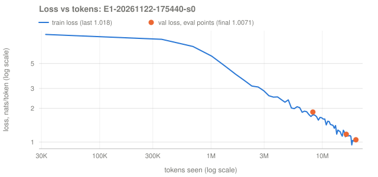
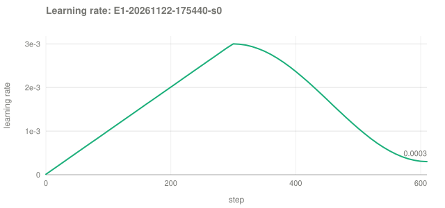
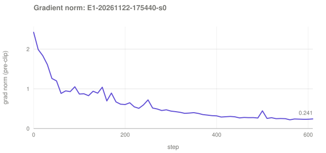
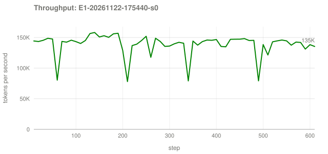
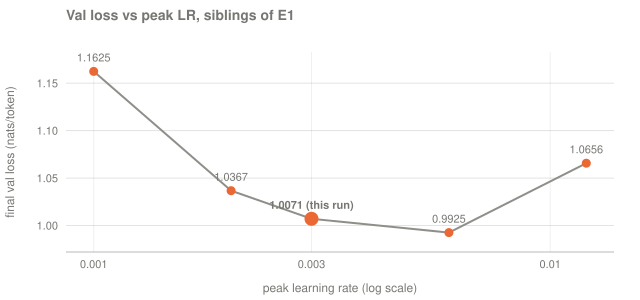

# Run report: E1-20261122-175440-s0

> Form status: **filled** by claude (run-form agent via gogeta-cockpit MCP) at 2026-11-22T18:41:25. Fields tagged `[machine]` were filled by the cockpit from run artifacts; fields tagged `[agent]` were written by the agent from the cited evidence. Generated by `cockpit/runform.py` (`gogeta_run_form_draft` then `gogeta_run_form_submit`).

> **Data caveat (K9) [machine].** K9 (experiments/cards/K9.md, v0.4.33) found the val split is 41.7% near-duplicates of train (1,667 of 4,000 val docs have >= 80% of their 13-grams in train). Every training-time val loss and bits/char below is inflated; comparisons may be confounded if architectures memorise repeats differently. A clean-val doc-level re-score is pending. See [`experiments/cards/K9.md`](../cards/K9.md); ledger C94, C107, C131.

> Clean-val score: **not yet available** (pending). Until it exists, read every val number on this page as inflated.

## 1. Identity and experiment

| Field | Value | Filled by |
|---|---|---|
| Run id | `E1-20261122-175440-s0` | machine |
| Experiment | E1: Linear-time mixers | machine |
| Arc | Ki Control | machine |
| Registry status / version | done / v0.3.0 | machine |
| Seed | 0 | machine |
| Question | Can Gated DeltaNet (vs Mamba-2 vs sliding-window only) plus one global attention layer match the baseline, while memory stops growing with context? | machine |
| Prediction (as registered) | Written 2026-11-22 before the run. Same depth, about the same params as E0, but only one full-attention layer. Val loss within +-2% of E0 and more likely slightly better (hybrids tend to win at short context; the 100-step bench was already lower: 2.58 vs 2.84). About 1.7x slower wall-clock than E0 because of the GDN kernels (100k vs 173k tok/s). If it is worse than E0 by >3%, suspect the GDN parametrisation or the SWA window. | machine |
| Config file | `configs/e1_hybrid.json` | machine |

## 2. Architecture

| Field | Value | Filled by |
|---|---|---|
| Summary | FusionDance d=384, 6 heads, MLP 1024, window 256; prelude ['swa', 'gdn', 'gdn', 'swa', 'gdn', 'attn'], core [], coda []; loops r=4 (train range 1-7), ternary=False | machine |
| Parameters total / non-embedding | 14,237,796 / 11,092,068 | machine |
| FLOPs per token (train, default loops) | 91,027,800 | machine |
| Loops r | 4 | machine |
| Source | meta.json config.params / config.model (recorded by gogeta.train from param_counts() and flops_per_token()) | machine |

## 3. Hyperparameters

| Field | Value | Filled by |
|---|---|---|
| Peak lr | 0.003 | machine |
| Schedule | linear warmup then cosine to min_lr_frac x lr (gogeta/train.py:132-136; formula, not logged per run) | machine |
| Warmup steps / min_lr_frac | 300 / 0.1 | machine |
| Batch x seq len (tokens/step) | 32 x 1024 (32,768) | machine |
| Token budget / tokens trained / steps | 20,000,000 / 20,021,248 / 611 | machine |
| Optimiser | AdamW betas [0.9, 0.95], weight decay 0.1, grad clip 1.0 | machine |
| Eval | every 250 steps on 128 sequences | machine |
| Dataset | code-py-v1 | machine |
| Precision / compile | bf16 autocast (gogeta/train.py:144; not logged per run) / compile=True | machine |
| Seed | 0 | machine |

## 4. Provenance and environment

| Field | Value | Filled by |
|---|---|---|
| Commit | `f8d4ed5a1a8301288848e7824cd89345b008e9e8` | machine |
| Version tag (git describe) | `v0.4.21-dirty` (dirty=True, code_dirty=False) | machine |
| CLI overrides | `{"max_tokens": 20000000, "seed": 0, "lr": 0.003}` | machine |
| Command | `/root/.venvs/gogeta/bin/python -m gogeta.train --config configs/e1_hybrid.json --compile --require-clean --seed 0 --max-tokens 20000000 --lr 3e-3` | machine |
| Campaign / item | phase2a-k7-lr-resume item 6/7 | machine |
| Training log | `E1-s0-20261122-175428.log` | machine |
| Torch / GPU / driver | not recorded / not recorded per run (host GPU now: NVIDIA RTX Spark N1X (6144-core Blackwell RTX GPU), 621.24) / not recorded per run | machine |
| Launcher env | `GOGETA_TRACKER=trackio PYTHONUNBUFFERED=1 TRACKIO_DIR=/root/fusiondance-data/trackio GOGETA_DATA=/root/fusiondance-data` | machine |
| Peak GPU memory (GB) | 7.10 | machine |

## 5. Timing and status

| Field | Value | Filled by |
|---|---|---|
| Started / finished | 2026-11-22T17:54:43 / 2026-11-22T17:57:25 | machine |
| Wall time (min) | 2.52 | machine |
| Throughput (tokens/s, average) | 132,370 | machine |
| Status / exit code | done / 0 | machine |
| FLOPs total | 1.822e+15 | machine |

## 6. Results (training-time val: inflated, see the caveat)

| Field | Value | Filled by |
|---|---|---|
| Final val loss (nats/token) | 1.0071 | machine |
| Final val bits/char | 0.3905 | machine |
| Train loss, last logged / mean of last 5 | 1.0175 / 1.0285 | machine |
| Best periodic val loss, 128-seq eval (step) | 1.0489 (step 610) | machine |
| Tokens to reach within 10% of the last periodic val | 20,021,248 | machine |
| Max grad norm after warmup | 0.446 | machine |
| Train-loss jumps > 0.5 after warmup | [] | machine |
| Reached token budget | True | machine |
| Series source | trackio:gogeta-0.db (62 train, 3 val points) | machine |

## 7. Siblings

Finished runs of E1 at the same token budget [machine]:

| Run | Seed | Peak lr | Val loss | Val bits/char | |
|---|---|---|---|---|---|
| `E1-20261122-174549-s0` | 0 | 0.001 | 1.1625 | 0.4507 |  |
| `E1-20261122-175030-s0` | 0 | 0.002 | 1.0367 | 0.4020 |  |
| `E1-20261122-175440-s0` | 0 | 0.003 | 1.0071 | 0.3905 | **this run** |
| `E1-20261122-175844-s0` | 0 | 0.006 | 0.9925 | 0.3848 |  |
| `E1-20261122-180627-s0` | 0 | 0.012 | 1.0656 | 0.4132 |  |

Context, other experiments at the same token budget [machine]: E10 s0 lr 0.001 val 1.2385; E10 s0 lr 0.002 val 1.0650; E10 s0 lr 0.003 val 1.0286; E10 s0 lr 0.006 val 1.0889

Same experiment, other token budget [machine]: `E1-20261122-124440-s0`

## 8. Related ledger claims [machine]

Latest status per claim from `experiments/claims.md` (append-only ledger; last row wins).

| Claim | Status | Statement |
|---|---|---|
| [C5](../claims.md#L253) | PARTIAL (pending clean-val re-score, K9) | The hybrid stack (E1) beats dense attention (E0) at 14M params / 200M tokens of Python |
| [C6](../claims.md#L254) | PARTIAL | Looping E2's core does not beat E0/E1 at ~2x the compute |
| [C9](../claims.md#L257) | PARTIAL | Ternary shrinks the E1 body 22.2 to 2.8 MB, whole model 28.5 to 9.1 MB |
| [C95](../claims.md#L272) | VERIFIED | E1 vs E0 is matched tokens, near-matched params, not matched compute |
| [C21](../claims.md#L50) | UNVERIFIED | Mamba-3 beats Gated DeltaNet (+0.6 pts avg downstream at 1.5B; MIMO +1.8) |
| [C28](../claims.md#L280) | UNVERIFIED (downgraded from PARTIAL: no findable evidence) | Lower loss doesn't guarantee better downstream ability (larger n-gram vocab: loss keeps falling, benchmarks saturate) |
| [C55](../claims.md#L92) | UNVERIFIED | Weight-shared loops create repetition "attractor wells": Auron needs presence penalty ≥ 1.5 when sampling |
| [C73](../claims.md#L166) | UNVERIFIED | Channel-wise (per-key-dim) decay beats GDN's head-wise scalar decay in a hybrid: Kimi Linear vs GDN-H, e.g. MMLU-Pro 51.0 vs 47.9, RULER 84.3 vs 80.5, long-context avg 54.5 vs 51.2; faster MQAR/palindrome convergence (Fi |
| [C77](../claims.md#L170) | UNVERIFIED | Short convolutions still matter in a hybrid (val PPL 5.70 without vs 5.65 with) |
| [C91](../claims.md#L135) | PARTIAL | Adding `"arch": "hf_llama"` to `gogeta/train.py` leaves FusionDance training unchanged |
| [C93](../claims.md#L137) | UNVERIFIED | Seed-to-seed std of the final val loss is ≤ 0.004 (so a 0.02 gap is real) |
| [C94](../claims.md#L241) | REFUTED (leakage present) | Our ~0.23 bits/char on held-out Python is plausible for this corpus (not a bug or train/val leakage) |

## 9. Narrative [agent]

Written by **claude (run-form agent via gogeta-cockpit MCP)** at 2026-11-22T18:41:25 from the evidence in sections 1-8 and the links below.

**Purpose** [agent]

One point of the K7 learning-rate sweep for E1 (FusionDance hybrid): peak lr 0.003, seed 0, 20M tokens, to pick the LR that Phase 2b uses (experiments/cards/K7.md).

**What happened** [agent]

Clean run: exit 0, 2.52 min, 132370 tokens/s average, max grad norm after warmup 0.446, no train-loss jump above 0.5 after warmup (cockpit computed from Trackio, 62 points). Launched by campaign phase2a-k7-lr-resume item 6/7 on v0.4.21-dirty.  Warmup is 300 of 611 steps (49% of the run), so the schedule is short-horizon (experiments/cards/K7.md, Caveats).

**Comparison with siblings** [agent]

20M-token siblings of E1 (same seed, other peak LR), final val loss: lr 0.001: 1.1625; lr 0.002: 1.0367; lr 0.003: 1.0071; lr 0.006: 0.9925; lr 0.012: 1.0656. At the same LR the E10 run (E10-20261122-173914-s0) scored 1.0286, so E1 is -2.1% vs it.

**Verdict** [agent]

Counts toward C92 (is 3e-3 a good LR?): informs. This run is one point of the E1 20M-token LR sweep: it is 1.5% worse than the tuned-LR run (lr 0.006, 0.9925), rank 2 of 5 by final val loss. Single seed, 20M-token proxy, and val is the K9-inflated split (a within-model LR ranking on one split is probably robust, but that is an inference, not tested).

**Follow-ups** [agent]

Re-check the K7 optima on clean val (ledger row 'K9 impact' for C92 asks for it) and run the planned 200M horizon check (DEVLOG.md Fair-HPO plan lists E1@3e-3, E10@6e-3, E10@2e-3). Phase 2b uses E1 at 6e-3.

**Claims this run counts toward** [agent]

| Claim | Effect | Evidence pointer |
|---|---|---|
| C92 (PARTIAL (pending clean-val check)) | informs | experiments/checks/results/K7.json, experiments/cards/K7.md (run E1-20261122-175440-s0 at v0.4.21-dirty) |

## 10. Graphs [machine]

Skipped charts (data not recorded): loops: not a looped run (no val_loss_r<k> metrics)

## 11. Links [machine]

- Experiment card: [`experiments/cards/E1.md`](../../experiments/cards/E1.md)
- Micro devlog: [`experiments/devlogs/E1.md`](../../experiments/devlogs/E1.md)
- Campaign file: [`experiments/launch/campaigns/phase2a-k7-lr-resume.campaign`](../../experiments/launch/campaigns/phase2a-k7-lr-resume.campaign)
- Related: [`experiments/cards/K7.md`](../../experiments/cards/K7.md)
- Related: [`experiments/devlogs/K7.md`](../../experiments/devlogs/K7.md)
- Related: [`experiments/devlogs/K7-stage1.md`](../../experiments/devlogs/K7-stage1.md)
- Related: [`experiments/checks/results/K7.json`](../../experiments/checks/results/K7.json)
- K9 caveat card: [`experiments/cards/K9.md`](../cards/K9.md)
- Trackio: http://127.0.0.1:7861 (project gogeta-0, run E1-20261122-175440-s0)
- Ledger: [`experiments/claims.md`](../claims.md), [`experiments/claims-status.md`](../claims-status.md)
