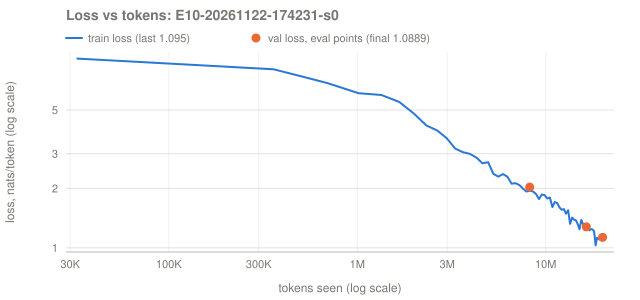
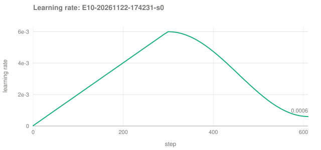
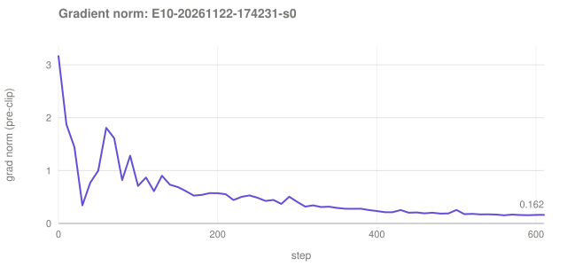
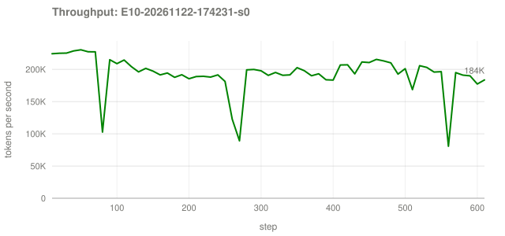
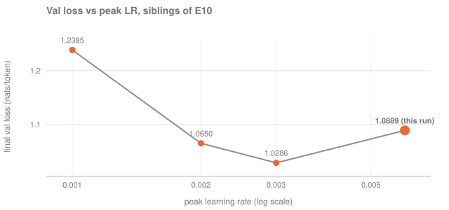

# Run report: E10-20261122-174231-s0

> Form status: **filled** by claude (run-form agent via gogeta-cockpit MCP) at 2026-11-22T18:41:37. Fields tagged `[machine]` were filled by the cockpit from run artifacts; fields tagged `[agent]` were written by the agent from the cited evidence. Generated by `cockpit/runform.py` (`gogeta_run_form_draft` then `gogeta_run_form_submit`).

> **Data caveat (K9) [machine].** K9 (experiments/cards/K9.md, v0.4.33) found the val split is 41.7% near-duplicates of train (1,667 of 4,000 val docs have >= 80% of their 13-grams in train). Every training-time val loss and bits/char below is inflated; comparisons may be confounded if architectures memorise repeats differently. A clean-val doc-level re-score is pending. See [`experiments/cards/K9.md`](../cards/K9.md); ledger C94, C107, C131.

> Clean-val score: **not yet available** (pending). Until it exists, read every val number on this page as inflated.

## 1. Identity and experiment

| Field | Value | Filled by |
|---|---|---|
| Run id | `E10-20261122-174231-s0` | machine |
| Experiment | E10: Reference control: Hugging Face Llama at E0's size | machine |
| Arc | Scouter Calibration | machine |
| Registry status / version | planned / None | machine |
| Seed | 0 | machine |
| Question | Is our own dense baseline (E0) a fair yardstick? Hugging Face's unmodified LlamaForCausalLM at exactly E0's size (13.77M params, 10.62M non-embedding, same FLOPs), trained with the same data and loop at its own tuned learning rate and 3 seeds, becomes the control every other model is compared to. | machine |
| Prediction (as registered) | Written 2026-11-22, before any E10 run. E10 = transformers 5.24.0 LlamaForCausalLM at E0's shapes: 13,767,552 total / 10,621,824 non-embedding params and 96.76M train FLOPs/token, all identical to E0 (computed, check k7_e10_parity.py). (1) At its K7-tuned LR, 200M tokens, seeds 0/1/2: mean full-val loss 0.595-0.615 (most likely ~0.603), seed std <= 0.004. (2) Implementation parity: E0 at the same LR lands within E10's mean +- max(3 x std, 0.5%), i.e. HF's init (std 0.02 everywhere, no residual-output scaling), half-split RoPE and eps 1e-6 change little. (3) E1 at its own tuned LR still beats E10: mean(E1) < mean(E10) by 1.5-4% (the 3.6% gap vs untuned E0 shrinks but survives tuning). (4) Compiled throughput within +-20% of E0 (about 170-250k tok/s steady). (5) Stable: no train-loss jumps > 0.5 after warmup. Pass criteria: experiments/checks/PREDICTIONS.md (K7, replication). | machine |
| Config file | `configs/e10_llama_ref.json` | machine |

## 2. Architecture

| Field | Value | Filled by |
|---|---|---|
| Summary | Hugging Face LlamaForCausalLM (transformers 5.24.0): 6 layers, hidden 384, 6 heads, MLP 1024, vocab 8192, tied embeddings True | machine |
| Parameters total / non-embedding | 13,767,552 / 10,621,824 | machine |
| FLOPs per token (train, default loops) | 96,758,784 | machine |
| Loops r | n/a (no loop) | machine |
| Source | meta.json config.params / config.model (recorded by gogeta.train from param_counts() and flops_per_token()) | machine |

## 3. Hyperparameters

| Field | Value | Filled by |
|---|---|---|
| Peak lr | 0.006 | machine |
| Schedule | linear warmup then cosine to min_lr_frac x lr (gogeta/train.py:132-136; formula, not logged per run) | machine |
| Warmup steps / min_lr_frac | 300 / 0.1 | machine |
| Batch x seq len (tokens/step) | 32 x 1024 (32,768) | machine |
| Token budget / tokens trained / steps | 20,000,000 / 20,021,248 / 611 | machine |
| Optimiser | AdamW betas [0.9, 0.95], weight decay 0.1, grad clip 1.0 | machine |
| Eval | every 250 steps on 128 sequences | machine |
| Dataset | code-py-v1 | machine |
| Precision / compile | bf16 autocast (gogeta/train.py:144; not logged per run) / compile=True | machine |
| Seed | 0 | machine |

## 4. Provenance and environment

| Field | Value | Filled by |
|---|---|---|
| Commit | `48862f946d65ddaa52e946483fa8b85accf828ac` | machine |
| Version tag (git describe) | `v0.4.18-dirty` (dirty=True, code_dirty=False) | machine |
| CLI overrides | `{"max_tokens": 20000000, "seed": 0, "lr": 0.006}` | machine |
| Command | `/root/.venvs/gogeta/bin/python -m gogeta.train --config configs/e10_llama_ref.json --compile --require-clean --seed 0 --max-tokens 20000000 --lr 6e-3` | machine |
| Campaign / item | phase2a-k7-lr-resume item 3/7 | machine |
| Training log | `E10-s0-20261122-174222.log` | machine |
| Torch / GPU / driver | not recorded / not recorded per run (host GPU now: NVIDIA RTX Spark N1X (6144-core Blackwell RTX GPU), 621.24) / not recorded per run | machine |
| Launcher env | `GOGETA_TRACKER=trackio PYTHONUNBUFFERED=1 TRACKIO_DIR=/root/fusiondance-data/trackio GOGETA_DATA=/root/fusiondance-data` | machine |
| Peak GPU memory (GB) | 4.39 | machine |

## 5. Timing and status

| Field | Value | Filled by |
|---|---|---|
| Started / finished | 2026-11-22T17:42:33 / 2026-11-22T17:44:31 | machine |
| Wall time (min) | 1.84 | machine |
| Throughput (tokens/s, average) | 181,808 | machine |
| Status / exit code | done / 0 | machine |
| FLOPs total | 1.937e+15 | machine |

## 6. Results (training-time val: inflated, see the caveat)

| Field | Value | Filled by |
|---|---|---|
| Final val loss (nats/token) | 1.0889 | machine |
| Final val bits/char | 0.4222 | machine |
| Train loss, last logged / mean of last 5 | 1.0955 / 1.1114 | machine |
| Best periodic val loss, 128-seq eval (step) | 1.1293 (step 610) | machine |
| Tokens to reach within 10% of the last periodic val | 20,021,248 | machine |
| Max grad norm after warmup | 0.407 | machine |
| Train-loss jumps > 0.5 after warmup | [] | machine |
| Reached token budget | True | machine |
| Series source | trackio:gogeta-0.db (62 train, 3 val points) | machine |

## 7. Siblings

Finished runs of E10 at the same token budget [machine]:

| Run | Seed | Peak lr | Val loss | Val bits/char | |
|---|---|---|---|---|---|
| `E10-20261122-172534-s0` | 0 | 0.001 | 1.2385 | 0.4802 |  |
| `E10-20261122-173601-s0` | 0 | 0.002 | 1.0650 | 0.4129 |  |
| `E10-20261122-173914-s0` | 0 | 0.003 | 1.0286 | 0.3988 |  |
| `E10-20261122-174231-s0` | 0 | 0.006 | 1.0889 | 0.4222 | **this run** |

Context, other experiments at the same token budget [machine]: E1 s0 lr 0.001 val 1.1625; E1 s0 lr 0.002 val 1.0367; E1 s0 lr 0.003 val 1.0071; E1 s0 lr 0.006 val 0.9925; E1 s0 lr 0.012 val 1.0656

Same experiment, other token budget [machine]: `E10-20261122-181334-s0`

## 8. Related ledger claims [machine]

Latest status per claim from `experiments/claims.md` (append-only ledger; last row wins).

| Claim | Status | Statement |
|---|---|---|
| [C90](../claims.md#L134) | VERIFIED (computed) | Hugging Face's `LlamaForCausalLM` at E0's shapes (E10) has exactly E0's parameter count (13,767,552 total / 10,621,824 non-embedding) and analytic train FLOPs (96,758,784 per token at seq 1024) |
| [C93](../claims.md#L137) | UNVERIFIED | Seed-to-seed std of the final val loss is ≤ 0.004 (so a 0.02 gap is real) |
| [C94](../claims.md#L241) | REFUTED (leakage present) | Our ~0.23 bits/char on held-out Python is plausible for this corpus (not a bug or train/val leakage) |
| [C107](../claims.md#L242) | VERIFIED (and it matters) | The val split is exact-dedup only (no near-duplicate removal) |
| [C131](../claims.md#L243) | VERIFIED | The training corpus (code-py-v1, OpenCoder annealing Python) is heavily self-duplicated, so any random split leaks |

## 9. Narrative [agent]

Written by **claude (run-form agent via gogeta-cockpit MCP)** at 2026-11-22T18:41:37 from the evidence in sections 1-8 and the links below.

**Purpose** [agent]

One point of the K7 learning-rate sweep for E10 (HF Llama control): peak lr 0.006, seed 0, 20M tokens, to pick the LR that Phase 2b uses (experiments/cards/K7.md).

**What happened** [agent]

Clean run: exit 0, 1.84 min, 181808 tokens/s average, max grad norm after warmup 0.407, no train-loss jump above 0.5 after warmup (cockpit computed from Trackio, 62 points). Launched by campaign phase2a-k7-lr-resume item 3/7 on v0.4.18-dirty.  Warmup is 300 of 611 steps (49% of the run), so the schedule is short-horizon (experiments/cards/K7.md, Caveats).

**Comparison with siblings** [agent]

20M-token siblings of E10 (same seed, other peak LR), final val loss: lr 0.001: 1.2385; lr 0.002: 1.0650; lr 0.003: 1.0286; lr 0.006: 1.0889. At the same LR the E1 run (E1-20261122-175844-s0) scored 0.9925, so E10 is +9.7% vs it.

**Verdict** [agent]

Counts toward C92 (is 3e-3 a good LR?): it informs, it does not settle it. This run is one point of the E10 20M-token LR sweep: it is 5.9% worse than the tuned-LR run (lr 0.003, 1.0286), rank 3 of 4 by final val loss. Single seed, 20M-token proxy, and val is the K9-inflated split (a within-model LR ranking on one split is probably robust, but that is an inference, not tested).

**Follow-ups** [agent]

Re-check the K7 optima on clean val (ledger row 'K9 impact' for C92 asks for it) and run the planned 200M horizon check (DEVLOG.md Fair-HPO plan lists E1@3e-3, E10@6e-3, E10@2e-3). Phase 2b uses E10 at 3e-3.

**Claims this run counts toward** [agent]

| Claim | Effect | Evidence pointer |
|---|---|---|
| C92 (PARTIAL (pending clean-val check)) | informs | experiments/checks/results/K7.json, experiments/cards/K7.md (run E10-20261122-174231-s0 at v0.4.18-dirty) |

## 10. Graphs [machine]

Skipped charts (data not recorded): loops: not a looped run (no val_loss_r<k> metrics)

## 11. Links [machine]

- Experiment card: [`experiments/cards/E10.md`](../../experiments/cards/E10.md)
- Micro devlog: [`experiments/devlogs/E10.md`](../../experiments/devlogs/E10.md)
- Campaign file: [`experiments/launch/campaigns/phase2a-k7-lr-resume.campaign`](../../experiments/launch/campaigns/phase2a-k7-lr-resume.campaign)
- Related: [`experiments/cards/K7.md`](../../experiments/cards/K7.md)
- Related: [`experiments/devlogs/K7.md`](../../experiments/devlogs/K7.md)
- Related: [`experiments/devlogs/K7-stage1.md`](../../experiments/devlogs/K7-stage1.md)
- Related: [`experiments/checks/results/K7.json`](../../experiments/checks/results/K7.json)
- K9 caveat card: [`experiments/cards/K9.md`](../cards/K9.md)
- Trackio: http://127.0.0.1:7861 (project gogeta-0, run E10-20261122-174231-s0)
- Ledger: [`experiments/claims.md`](../claims.md), [`experiments/claims-status.md`](../claims-status.md)
