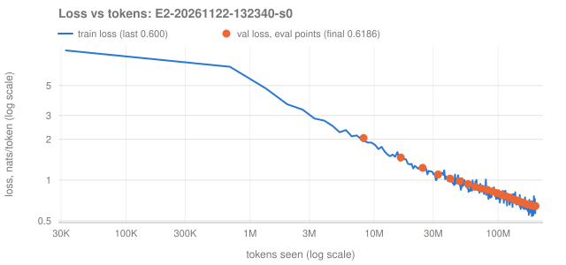
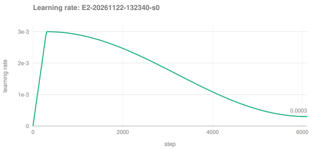
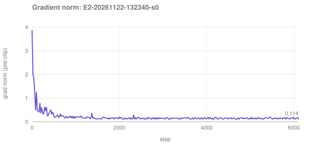
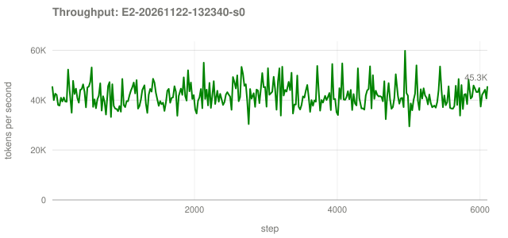
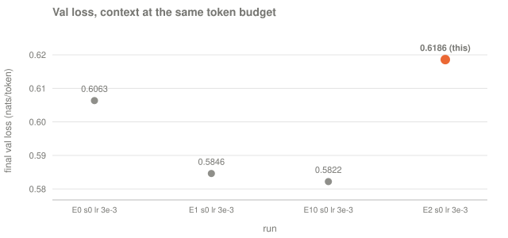
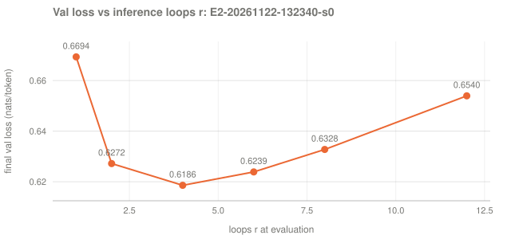

# Run report: E2-20261122-132340-s0

> Form status: **filled** by claude (run-form agent via gogeta-cockpit MCP) at 2026-11-22T18:41:40. Fields tagged `[machine]` were filled by the cockpit from run artifacts; fields tagged `[agent]` were written by the agent from the cited evidence. Generated by `cockpit/runform.py` (`gogeta_run_form_draft` then `gogeta_run_form_submit`).

> **Data caveat (K9) [machine].** K9 (experiments/cards/K9.md, v0.4.33) found the val split is 41.7% near-duplicates of train (1,667 of 4,000 val docs have >= 80% of their 13-grams in train). Every training-time val loss and bits/char below is inflated; comparisons may be confounded if architectures memorise repeats differently. A clean-val doc-level re-score is pending. See [`experiments/cards/K9.md`](../cards/K9.md); ledger C94, C107, C131.

> Clean-val score: **not yet available** (pending). Until it exists, read every val number on this page as inflated.

## 1. Identity and experiment

| Field | Value | Filled by |
|---|---|---|
| Run id | `E2-20261122-132340-s0` | machine |
| Experiment | E2: Looped core block | machine |
| Arc | Time Chamber | machine |
| Registry status / version | done / v0.3.0 | machine |
| Seed | 0 | machine |
| Question | Does one shared core block looped r times match a deeper unshared model with far fewer parameters? Does quality keep improving when r at test time exceeds r in training? | machine |
| Prediction (as registered) | Written 2026-11-22 before the run. At r=4 (about 2x E0's FLOPs/token, 11% fewer non-emb params), val loss matches E0 within +-3%, so we expect no win per token yet; the claim to test is the r curve. Predicted shape: r=1 clearly worse (> +10% vs r=4); r=2 < r=1; r=4 about r=6 (flat); r=8 about the same or slightly better than r=4; r=12 (beyond the trained max of 7) flat or slightly worse, not a collapse. Training is stable (no loss spikes > 0.5 after warmup). | machine |
| Config file | `configs/e2_looped.json` | machine |

## 2. Architecture

| Field | Value | Filled by |
|---|---|---|
| Summary | FusionDance d=384, 6 heads, MLP 1024, window 256; prelude ['swa'], core ['gdn', 'gdn', 'swa'], coda ['attn']; loops r=4 (train range 1-7), ternary=False | machine |
| Parameters total / non-embedding | 12,606,488 / 9,460,760 | machine |
| FLOPs per token (train, default loops) | 192,793,152 | machine |
| Loops r | 4 | machine |
| Source | meta.json config.params / config.model (recorded by gogeta.train from param_counts() and flops_per_token()) | machine |

## 3. Hyperparameters

| Field | Value | Filled by |
|---|---|---|
| Peak lr | 0.003 | machine |
| Schedule | linear warmup then cosine to min_lr_frac x lr (gogeta/train.py:132-136; formula, not logged per run) | machine |
| Warmup steps / min_lr_frac | 300 / 0.1 | machine |
| Batch x seq len (tokens/step) | 32 x 1024 (32,768) | machine |
| Token budget / tokens trained / steps | 200,000,000 / 200,015,872 / 6104 | machine |
| Optimiser | AdamW betas [0.9, 0.95], weight decay 0.1, grad clip 1.0 | machine |
| Eval | every 250 steps on 128 sequences | machine |
| Dataset | code-py-v1 | machine |
| Precision / compile | bf16 autocast (gogeta/train.py:144; not logged per run) / compile=True | machine |
| Seed | 0 | machine |

## 4. Provenance and environment

| Field | Value | Filled by |
|---|---|---|
| Commit | `0dc74914c541a281c06d0bdbd38eba5b1b2525a9` | machine |
| Version tag (git describe) | `v0.2.0-1-g0dc7491-dirty` (dirty=True, code_dirty=False) | machine |
| CLI overrides | not recorded | machine |
| Command | not recorded | machine |
| Campaign / item | none (launched directly or by run_queue.sh)  | machine |
| Training log | `e2_looped.log` | machine |
| Torch / GPU / driver | not recorded / not recorded per run (host GPU now: NVIDIA RTX Spark N1X (6144-core Blackwell RTX GPU), 621.24) / not recorded per run | machine |
| Launcher env | not recorded | machine |
| Peak GPU memory (GB) | 12.07 | machine |

## 5. Timing and status

| Field | Value | Filled by |
|---|---|---|
| Started / finished | 2026-11-22T13:23:41 / 2026-11-22T14:46:10 | machine |
| Wall time (min) | 80.27 | machine |
| Throughput (tokens/s, average) | 41,531 | machine |
| Status / exit code | done / None | machine |
| FLOPs total | 3.869e+16 | machine |

## 6. Results (training-time val: inflated, see the caveat)

| Field | Value | Filled by |
|---|---|---|
| Final val loss (nats/token) | 0.6186 | machine |
| Final val bits/char | 0.2398 | machine |
| Val loss by inference loops | r1: 0.6694, r2: 0.6272, r4: 0.6186, r6: 0.6239, r8: 0.6328, r12: 0.6540 | machine |
| Train loss, last logged / mean of last 5 | 0.5998 / 0.6019 | machine |
| Best periodic val loss, 128-seq eval (step) | 0.6423 (step 6103) | machine |
| Tokens to reach within 10% of the last periodic val | 147,488,768 | machine |
| Max grad norm after warmup | 0.668 | machine |
| Train-loss jumps > 0.5 after warmup | [] | machine |
| Reached token budget | True | machine |
| Series source | trackio:gogeta-0.db (612 train, 25 val points) | machine |

## 7. Siblings

Finished runs of E2 at the same token budget [machine]:

| Run | Seed | Peak lr | Val loss | Val bits/char | |
|---|---|---|---|---|---|
| `E2-20261122-132340-s0` | 0 | 0.003 | 0.6186 | 0.2398 | **this run** |

Context, other experiments at the same token budget [machine]: E0 s0 lr 0.003 val 0.6063; E1 s0 lr 0.003 val 0.5846; E10 s0 lr 0.003 val 0.5822

## 8. Related ledger claims [machine]

Latest status per claim from `experiments/claims.md` (append-only ledger; last row wins).

| Claim | Status | Statement |
|---|---|---|
| [C6](../claims.md#L254) | PARTIAL | Looping E2's core does not beat E0/E1 at ~2x the compute |
| [C7](../claims.md#L255) | PARTIAL | E2's loss gets worse when looping beyond the trained range |
| [C130](../claims.md#L279) | PARTIAL | The 3D page Play trace for E2 is the model's real computation |
| [C10](../claims.md#L29) | VERIFIED | Looping gives depth without new parameters (E2: 9.46M non-emb, behaves like 14 blocks) |
| [C20](../claims.md#L265) | REFUTED | E2's loop converges |
| [C39](../claims.md#L125) | UNVERIFIED (computed, not per-token) | From k ≥ 4, each E2 loop adds an increment of near-constant size (‖Δ_k‖ ≈ 4.6–5.0·‖h_0‖) almost parallel to the state, cos(Δ_k, h_{k−1}) = 0.95 → 0.97 (global flattened norms) |
| [C40](../claims.md#L126) | UNVERIFIED | Hypothesis: E2's loss rises past r=4 because the growing state "drowns" the pre-norm residual coda (its fixed-size update shrinks relative to ‖h‖) |
| [C59](../claims.md#L96) | UNVERIFIED (hypothesis) | E2's loop is a near-constant drift in a fixed direction (h_k ≈ h_1 + (k−1)·v); the falling relative change in K6 is mostly norm growth, not convergence |
| [C67](../claims.md#L104) | UNVERIFIED (hypothesis) | Weight sharing pays mainly when parameter-limited: published small looped wins train at ~2,000+ tokens per non-embedding param (MixerLoop 13M: 10B tokens, ~4.7M non-emb), vs E2 at ~21 |
| [C68](../claims.md#L105) | UNVERIFIED (computed; confirm with param_counts() / flops_per_token()) | On our core, MixerLoop T=4 costs the same projection FLOPs as our full-block loop at r=2 (E2 dims: 11.84M vs 11.82M matmul params per token; tiny d=128/mlp 344: 1.314M vs 1.317M), and the MLPs are ~60% of a core pass |
| [C28](../claims.md#L280) | UNVERIFIED (downgraded from PARTIAL: no findable evidence) | Lower loss doesn't guarantee better downstream ability (larger n-gram vocab: loss keeps falling, benchmarks saturate) |
| [C36](../claims.md#L122) | UNVERIFIED | Loops amplify quantisation error: INT4 GPTQ costs plain looped models +2.2/+2.2/+3.3% PPL vs +1.4/+0.8/+1.3% for depth-matched Transformers (136M/580M/990M); loop-level hyper-connections cut it to +1.9/+1.7/+1.2% |

## 9. Narrative [agent]

Written by **claude (run-form agent via gogeta-cockpit MCP)** at 2026-11-22T18:41:40 from the evidence in sections 1-8 and the links below.

**Purpose** [agent]

Looped-core test (E2, 'Time Chamber'): one shared core block [gdn, gdn, swa] looped r times (trained with r drawn from 1-7, evaluated at r in {1,2,4,6,8,12}), 200M tokens, to ask whether weight sharing buys depth cheaply and whether more loops at test time keep helping (experiments/cards/E2.md).

**What happened** [agent]

Ran to completion in 80.3 min (41.5k tokens/s, 12.07 GB peak), the slowest and most memory-hungry run; max logged grad norm after step 300 0.668 (matches the micro devlog's 0.67), no loss jump above 0.5. Launched by tools/run_queue.sh, no campaign id. Loss by inference loops: r1 0.6694, r2 0.6272, r4 0.6186, r6 0.6239, r8 0.6328, r12 0.6540: best at r=4 (the mean training r), worse beyond, so the loop does not converge to a fixed point. Its seed-1 replication (E2-20261122-152151-s1) was killed at step 200 when the agent session ended and has no summary, and the unlooped control E9 was interrupted at step 600; both are unfinished run folders without forms.

**Comparison with siblings** [agent]

No other finished E2 run. Same 200M budget and lr 3e-3: E0 0.6063 (E2 is +2.0%), E1 0.5846 (E2 is +5.8%), E10 seed 0 0.5822 (E2 is +6.3%). E2 spends 3.87e16 FLOPs, 2.0x E0 and 2.1x E1, so it is worse and costlier. It is behind E0 at every one of the 25 periodic evals and never reaches E0's final periodic val.

**Verdict** [agent]

Supports C6 (looping does not beat E0/E1 at about 2x the compute): +2.0% vs E0 and +5.8% vs E1 at 2.0x and 2.1x FLOPs, single seed, and the unlooped control E9 never completed. Supports C7 (loss gets worse beyond the trained range): r=4 0.6186 to r=8 0.6328 to r=12 0.6540. Both rest on one seed at an untuned LR, on K9-inflated val.

**Follow-ups** [agent]

E9 (unlooped control) and an E2 re-run at the tuned LR are queued for Phase 2b (queue item Q10 for E2 at 6e-3); clean-val re-score; the loop diagnostics (SQ14/SQ21/SQ37) want a fresh E2 checkpoint.

**Claims this run counts toward** [agent]

| Claim | Effect | Evidence pointer |
|---|---|---|
| C6 (PARTIAL) | supports | experiments/devlogs/E2.md, experiments/cards/E2.md, run E2-20261122-132340-s0 at v0.3.0 |
| C7 (PARTIAL) | supports | experiments/devlogs/E2.md and run E2-20261122-132340-s0 at v0.3.0 (per-loop val loss in the form) |

## 10. Graphs [machine]

## 11. Links [machine]

- Experiment card: [`experiments/cards/E2.md`](../../experiments/cards/E2.md)
- Micro devlog: [`experiments/devlogs/E2.md`](../../experiments/devlogs/E2.md)
- Related: [`experiments/cards/K6.md`](../../experiments/cards/K6.md)
- Related: [`experiments/devlogs/K6.md`](../../experiments/devlogs/K6.md)
- Related: [`experiments/devlogs/_proposed-evidence-rows.md`](../../experiments/devlogs/_proposed-evidence-rows.md)
- Related: [`experiments/checks/results/K6.json`](../../experiments/checks/results/K6.json)
- K9 caveat card: [`experiments/cards/K9.md`](../cards/K9.md)
- Trackio: http://127.0.0.1:7861 (project gogeta-0, run E2-20261122-132340-s0)
- Ledger: [`experiments/claims.md`](../claims.md), [`experiments/claims-status.md`](../claims-status.md)
