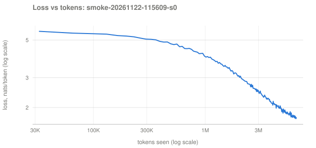

# Run report: smoke-20261122-115609-s0

> Form status: **filled** by claude (run-form agent via gogeta-cockpit MCP) at 2026-11-22T18:41:42. Fields tagged `[machine]` were filled by the cockpit from run artifacts; fields tagged `[agent]` were written by the agent from the cited evidence. Generated by `cockpit/runform.py` (`gogeta_run_form_draft` then `gogeta_run_form_submit`).

> **Data caveat (K9) [machine].** K9 (experiments/cards/K9.md, v0.4.33) found the val split is 41.7% near-duplicates of train (1,667 of 4,000 val docs have >= 80% of their 13-grams in train). Every training-time val loss and bits/char below is inflated; comparisons may be confounded if architectures memorise repeats differently. A clean-val doc-level re-score is pending. See [`experiments/cards/K9.md`](../cards/K9.md); ledger C94, C107, C131.

> Clean-val score: **not yet available** (pending). Until it exists, read every val number on this page as inflated.

## 1. Identity and experiment

| Field | Value | Filled by |
|---|---|---|
| Run id | `smoke-20261122-115609-s0` | machine |
| Experiment | smoke: not in registry | machine |
| Arc | not recorded | machine |
| Registry status / version | None / None | machine |
| Seed | 0 | machine |
| Question | not recorded | machine |
| Prediction (as registered) | not recorded | machine |
| Config file | not recorded | machine |

## 2. Architecture

| Field | Value | Filled by |
|---|---|---|
| Summary | not recorded (config keys: d_model, loops, lr, ternary) | machine |
| Parameters total / non-embedding | not recorded / not recorded | machine |
| FLOPs per token (train, default loops) | not recorded | machine |
| Loops r | n/a (no loop) | machine |
| Source | meta.json config.params / config.model (recorded by gogeta.train from param_counts() and flops_per_token()) | machine |

## 3. Hyperparameters

| Field | Value | Filled by |
|---|---|---|
| Peak lr | 0.003 | machine |
| Schedule | not recorded | machine |
| Warmup steps / min_lr_frac | None / None | machine |
| Batch x seq len (tokens/step) | None x None (not recorded) | machine |
| Token budget / tokens trained / steps | not recorded / not recorded / None | machine |
| Optimiser | AdamW betas [None, None], weight decay None, grad clip None | machine |
| Eval | every None steps on None sequences | machine |
| Dataset | not recorded | machine |
| Precision / compile | not recorded / compile=not recorded | machine |
| Seed | 0 | machine |

## 4. Provenance and environment

| Field | Value | Filled by |
|---|---|---|
| Commit | `ae6703bb86ba406479301394a142da2d7f18e628` | machine |
| Version tag (git describe) | `v0.1.2-dirty` (dirty=True, code_dirty=not recorded) | machine |
| CLI overrides | not recorded | machine |
| Command | not recorded | machine |
| Campaign / item | none (launched directly or by run_queue.sh)  | machine |
| Training log | `not found` | machine |
| Torch / GPU / driver | not recorded / not recorded per run (host GPU now: NVIDIA RTX Spark N1X (6144-core Blackwell RTX GPU), 621.24) / not recorded per run | machine |
| Launcher env | not recorded | machine |
| Peak GPU memory (GB) | not recorded | machine |

## 5. Timing and status

| Field | Value | Filled by |
|---|---|---|
| Started / finished | 2026-11-22T11:56:10 / 2026-11-22T11:56:11 | machine |
| Wall time (min) | not recorded | machine |
| Throughput (tokens/s, average) | not recorded | machine |
| Status / exit code | done / not recorded | machine |
| FLOPs total | not recorded | machine |

## 6. Results (training-time val: inflated, see the caveat)

| Field | Value | Filled by |
|---|---|---|
| Final val loss (nats/token) | 1.7372 | machine |
| Final val bits/char | not recorded | machine |
| Train loss, last logged / mean of last 5 | 1.7372 / 1.7428 | machine |
| Best periodic val loss, 128-seq eval (step) | not recorded (step None) | machine |
| Tokens to reach within 10% of the last periodic val | not recorded | machine |
| Max grad norm after warmup | not recorded | machine |
| Train-loss jumps > 0.5 after warmup | [] | machine |
| Reached token budget | False | machine |
| Series source | trackio:gogeta-0-smoke.db (200 train, 0 val points) | machine |

## 7. Siblings

Finished runs of smoke at the same token budget [machine]:

| Run | Seed | Peak lr | Val loss | Val bits/char | |
|---|---|---|---|---|---|
| `smoke-20261122-115609-s0` | 0 | 0.003 | 1.7372 | not recorded | **this run** |

## 8. Related ledger claims [machine]

Latest status per claim from `experiments/claims.md` (append-only ledger; last row wins).

| Claim | Status | Statement |
|---|---|---|
| [C82](../claims.md#L270) | PARTIAL | GRPO, SFT and DPO run end to end through TRL with our wrapper |
| [C94](../claims.md#L241) | REFUTED (leakage present) | Our ~0.23 bits/char on held-out Python is plausible for this corpus (not a bug or train/val leakage) |
| [C102](../claims.md#L182) | UNVERIFIED (reported; we have not run HumanEval on a trained checkpoint) | HumanEval pass@1 floors at our size: Codex-12M 2.00% (pass@100 8.58%) after 100B tokens, PolyCoder-160M 2.13%, CodeParrot-110M 3.80%; one problem = 0.61 pts, so variants ≲ 5 problems apart can't be told apart |
| [C107](../claims.md#L242) | VERIFIED (and it matters) | The val split is exact-dedup only (no near-duplicate removal) |
| [C124](../claims.md#L224) | UNVERIFIED | The batch path (`TokenData.batch`: numpy gather, int64, pin_memory, H2D) costs < 3% of an E0 step; a GPU-resident dataset gives bit-identical batches |
| [C131](../claims.md#L243) | VERIFIED | The training corpus (code-py-v1, OpenCoder annealing Python) is heavily self-duplicated, so any random split leaks |

## 9. Narrative [agent]

Written by **claude (run-form agent via gogeta-cockpit MCP)** at 2026-11-22T18:41:42 from the evidence in sections 1-8 and the links below.

**Purpose** [agent]

Smoke run: no science. An early plumbing check of the training loop and Trackio logging at v0.1.2.

**What happened** [agent]

Smoke run: no science. It finished with a val loss of 1.7372 in about one second; only a minimal summary.json was written (no tokens, steps, params or throughput), and no training log was found. Everything else is not recorded.

**Comparison with siblings** [agent]

Smoke run: no science, no siblings. A second smoke folder (smoke-20261122-115558-s0) has only meta.json.

**Verdict** [agent]

Smoke run: no science. It counts toward no claim.

**Follow-ups** [agent]

None: smoke run, nothing to follow up.

## 10. Graphs [machine]

Skipped charts (data not recorded): lr: no per-step learning rate recorded; grad_norm: no per-step gradient norm recorded; throughput: no per-step throughput recorded (perf/tokens_per_s); siblings: no sibling runs of smoke at this token budget and no other experiment at the same budget; loops: not a looped run (no val_loss_r<k> metrics)

## 11. Links [machine]

- K9 caveat card: [`experiments/cards/K9.md`](../cards/K9.md)
- Trackio: http://127.0.0.1:7861 (project gogeta-0, run smoke-20261122-115609-s0)
- Ledger: [`experiments/claims.md`](../claims.md), [`experiments/claims-status.md`](../claims-status.md)
